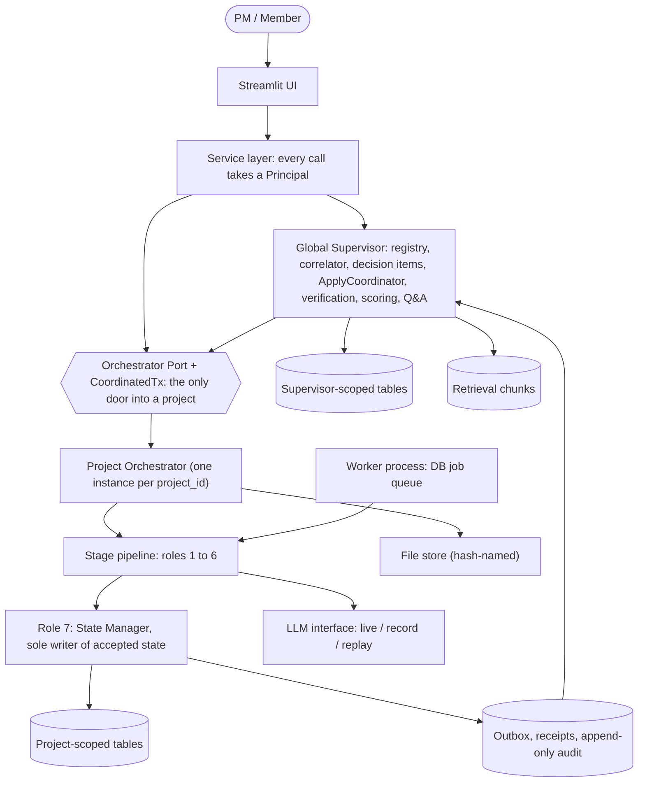
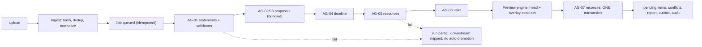
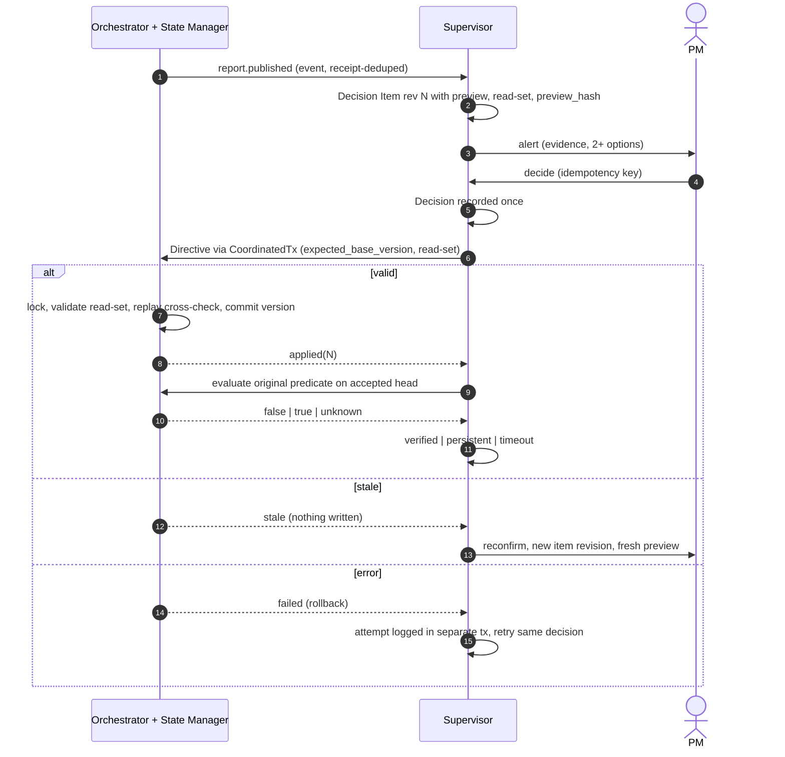
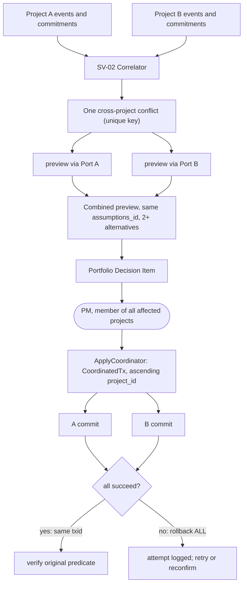
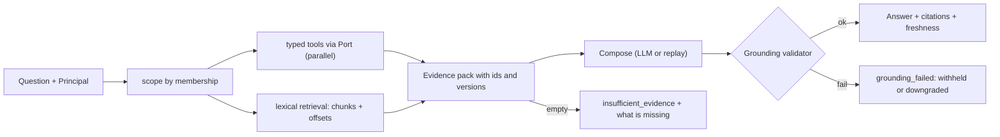
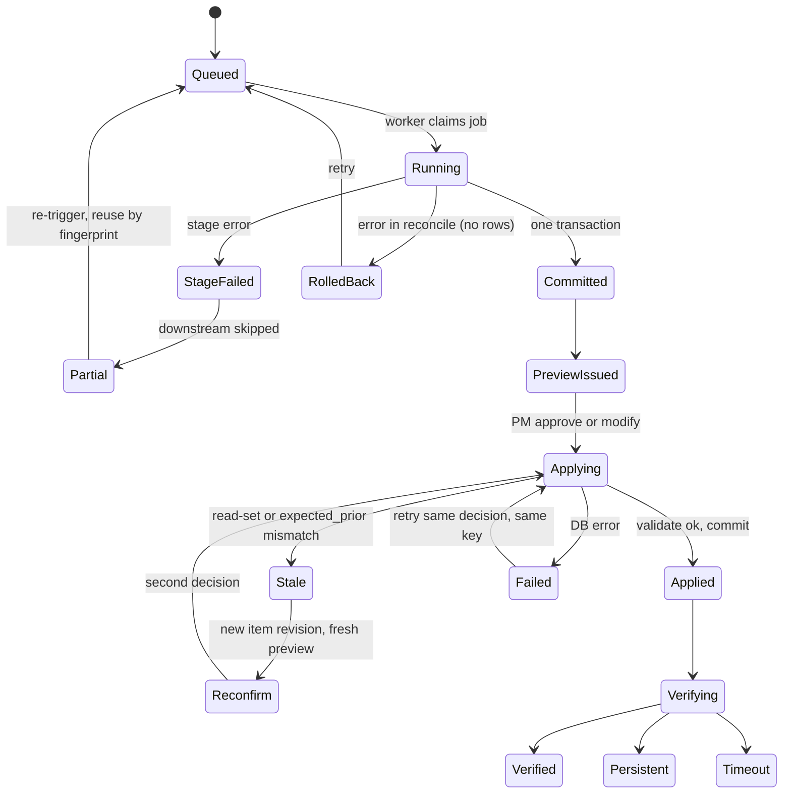
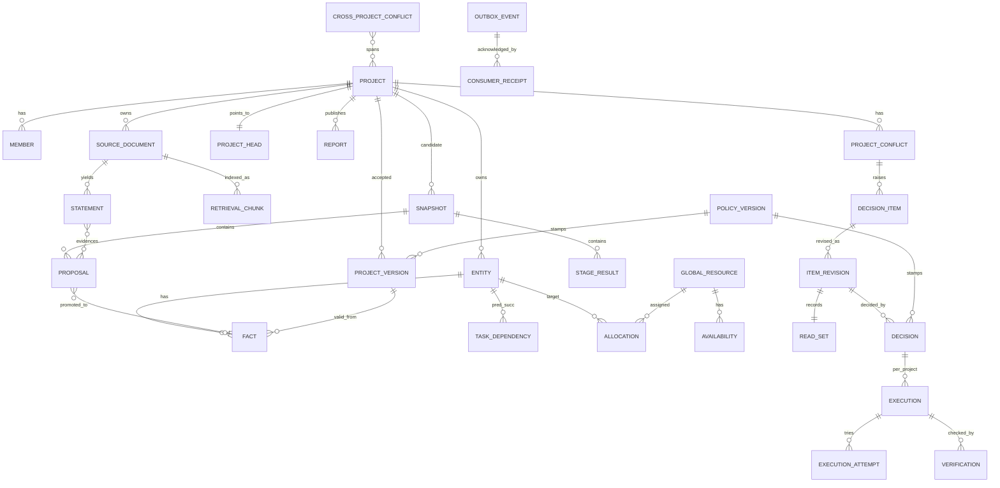

# MAPMS — Final System Design & Implementation Blueprint

**Status:** pre-implementation. No application code is written here.
**Audience:** the five-person graduation-project team.
**Source tags:** **[G]** Guide (8-page PDF and its three scenarios) · **[B]** your brief, clarifications and review corrections · **[R]** engineering recommendation · **[A]** assumption or temporary default.
**Approval rule:** nothing tagged [R] or [A] is approved unless §12.2 says you approved it. Where I rely on a decision you did not give, it is labeled *unapproved default* and fails safe.

## How to use this document

1. Read §1 (what is unresolved) and §2 (what MAPMS is) first.
2. Use §3–§6 as the design reference, §7–§8 for the repository and stack, §9 for data, §10 for the build order, §11 for tests, §12 for decisions and the checklist.
3. Component IDs (`AG-`, `SV-`, `SVC-`), invariant IDs (`INV-`), report IDs (`RPT-`), data IDs and test IDs are stable. Cross-reference them in PRs. Do not rename them.
4. Backlog IDs `B01`–`B50` and the test catalog (EV, PS, CC, RC, RS, XP, QA, VF, CM, SC, NT, K, AL, VN, RSC) come from the earlier phases and are kept unchanged so earlier work stays traceable.

---

## 1. Source status, blockers, and conflict resolutions

### 1.1 What was actually available

| Material | Status | Consequence |
|---|---|---|
| *Multi-Agent PM System: Architecture and step-by-step workflow guide* (8 pp.) | Reviewed. It calls itself "a companion to the interactive simulation", has no requirement numbering and no policies, schemas, scoring or estimates. | Everything tagged [G] rests on this one document. A fuller original Guide may exist (blocking decision 3). |
| Simulation HTML, its text extract, and a screenshot PDF | Reviewed as derived material. The screenshot has a layout defect. | Diagram evidence only, not normative. |
| Your brief and review corrections | Reviewed through the earlier phases. | Source of most guarantees ([B]). |
| Phases 1–4 reviews and the Execution Package | Present in this conversation and consolidated here. | Reused, with the reconciliations in §1.3. |
| **Previous plans, earlier architecture reviews, "latest design review"** | **Never attached. Not reviewed.** | Deliverable 4 (previous-plan audit) stays **blocked**. I do not reconstruct their content. |
| Two unrelated PDFs (image-processing workbook, *Learning From Data*) | Ignored. | Possible later citation for evaluation methodology only. |

### 1.2 Facts I lack (not decisions)

- **LLM access on Day 1.** The live spike (B08) needs someone able to run live calls. Without it, extraction quality is unmeasured and the demo carries a REPLAY banner.
- **Real transcripts and real numbers.** None supplied. §9 specifies a synthetic portfolio. The spike then measures format reliability, not real-world quality [A].
- **Resource and rate data (D10).** No owner identified. Capacity and cost stay `unknown` unless the synthetic roster is used, which is always labeled demo data.

### 1.3 Conflicts between earlier documents, and the resolution used in this blueprint

| # | Conflict | Impact | Resolution [R] |
|---|---|---|---|
| K-1 | Guide step 10 persists "state v12" before the PM decides (step 13). Brief requires that LLM output never overwrites accepted facts. | Literal reading commits unapproved changes. | Candidate **snapshot** is persisted; an accepted **version** is created only by State Manager commit (INV-01, INV-05). Reading of "v12" as a candidate is [A] (U1) and needs your confirmation (blocking decision 3). |
| K-2 | Phase 2 drew an "API layer" box; Phase 3 replaced it with an in-process service layer. | Diagram inconsistency. | Service layer with `Principal`; FastAPI deferred (P1). §2.6 and the diagrams use the service layer. |
| K-3 | Phase 3 scheduled S0 green by Day 7 and coordinated apply in Week 2; Phase 4 moved Spike X into Days 3–5; Execution Package moved S0 to Day 12 (S0a Day 9). | Three conflicting calendars. | Execution Package calendar governs (§10). |
| K-4 | Phase 3 tiers T1–T5. Phase 4's T4 cut CM2–CM5, VF5, and cost/ramp-up, which are approved requirements ([B]). | Cuts contradicted requirements. | Tier ladder retired. One **Core** scope plus priced enhancements (§10.2). CM5 is the only completion item left optional (E1). |
| K-5 | Top-down Core estimate 64.5–94.5 pd vs bottom-up 103.75 pd. About 11.5 pd of the gap is itemized, about 12.75 pd is unexplained. | Calendar risk. | Plan on 103.75 pd. Re-baseline on Day 7 (§10.4). |
| K-6 | Test count "57" vs 74 unique IDs. | Wrong claim. | 74 is correct; catalog is now 89 IDs (+RC1b optional = 90); Core is **84** (§11.2). |
| K-7 | Role 3 (User Story) is a separate logical role but bundled with Role 2 in the cost-saving mode. | Ambiguous deployment. | Separate logical roles with separate contracts. **Core deploys Roles 2+3 in one bundled LLM call** with per-section validation and separate `StageResult` rows (D11). |
| K-8 | Phase 2 allowed LLM-assisted Role 4; Core budget has none. | Scope. | Role 4 is deterministic in Core; LLM decomposition is P1. |
| K-9 | Execution Package says "RC1: crash, then re-trigger resumes". Phase 3 defined lease-based takeover. | Test meaning differs. | Core RC1 = re-trigger resumption. Lease takeover is enhancement E2 (test RC1b). |
| K-10 | Phase 3 said PM "ask questions / set priorities" [G] but brief adds "request analysis / provide information" [B]. | Decision vocabulary. | Both supported as non-resolving acts (§4.B). |

### 1.4 Blocking decisions (kept visible; none stops this document)

| # | Decision | Needed by | If you say yes | If no / unanswered |
|---|---|---|---|---|
| 1 | Capacity and calendar: sustained hours per person, and whether the date is fixed. | Day 7 re-baseline | At 28 h/week Core is about 4.5 weeks; 32 h about 3.9 weeks. | Core build continues, no demo date committed, nothing cut. Floor scope (drop Scenario 3) only with your acknowledgement. |
| 2 | Is logical isolation in one shared PostgreSQL acceptable, and does "change together" mean all-or-none? | Gate D5 (Day 5) | Coordinated single-transaction apply. | All-or-none is unavailable without two-phase commit or a saga. Falls back to ordered idempotent apply with visible `partially_applied`. The Core build (B12+) does not start without an answer. |
| 3 | Is the 8-page PDF the authoritative Guide, and does "v12" mean a candidate snapshot? | Day 3 (Freeze-1) | Freeze-1 proceeds. | Freeze-1 does not happen; foundation and LLM work continue. |

---

## 2. Final system overview

### 2.1 The problem [G]

A PM runs several projects whose plans, resources and risks interact. Inputs arrive as messy text (meeting transcripts, documents, updates). Conflicts such as one person on two critical paths are invisible inside a single project. MAPMS turns messy input into evidence-backed proposals, finds conflicts inside and across projects, puts decisions in front of the PM, applies approved decisions safely, and checks that the conflict actually went away.

### 2.2 Users and what they can do

| User | Can do | Cannot do |
|---|---|---|
| **PM account** [G] | Approve, reject, modify, defer; request analysis; provide information; set priorities; ask portfolio questions; trigger rollback (API/script in Core). Final authority. | Decide on a portfolio item unless a member of all affected projects [A, U8]. |
| **Member account** | View their projects, submit documents, ask scoped questions, see pending proposals read-only. | Resolve any decision item, by UI or service call (SC3). |
| **Viewer** | Read dashboards for projects they belong to. | Submit or decide. |
| **Admin** | Manage accounts, project registry, policy versions. | Bypass authorization or audit. |

Account roles decide *who may call* an operation. **Domain decision rights** (the authority matrix, §6.4) decide *whether a statement may ground a change*. They are separate checks [R].

### 2.3 Story from the outside in

1. **New project.** An admin creates a registry row, roster, defaults and a bootstrap version v1 with a project-level planning bucket entity. A Project Orchestrator instance now exists for it (one code base, scoped by `project_id`). No Supervisor code changes [G scalability, R20].
2. **Input.** A transcript or document is submitted to that project's Orchestrator. It is stored immutably (hash-named file, metadata row), de-duplicated and normalized.
3. **Extraction is not truth.** Role 1 extracts *statements* (speaker, kind, topic, quote locator). The quote must be a substring of the stored text or the statement is rejected.
4. **Proposals, not facts.** Later roles turn validated statements into *proposals* (requirements, stories, tasks, allocations, risks) using provisional keys. Proposals live in their own tables. Only the State Manager can write accepted facts, and only with an authorization.
5. **Analysis.** Deterministic code computes the critical path, per-person load and overload. Overload is data, not LLM prose. Missing capacity is `unknown`.
6. **Report up.** The Orchestrator publishes a versioned report and outbox events. The Supervisor sees projects only through the Port and these reports.
7. **Conflict to decision.** The Supervisor creates a Decision Item with at least two alternatives, an impact preview labeled hypothetical, evidence, and the preview's read-set.
8. **PM decides.** The decision is recorded exactly once. Execution (apply) is a separate record, verification a third.
9. **Apply.** The Supervisor opens a coordinated transaction. Each Orchestrator validates the read-set and commits through its own State Manager. A stale or failing apply writes nothing.
10. **Verify.** The original conflict predicate is re-evaluated on the accepted head. Outcomes are distinct: verified, persistent, new conflict introduced, timeout, manual.
11. **Portfolio questions.** The Supervisor queries project interfaces and a document index, composes an answer with citations, validates every citation, or answers "insufficient evidence".

### 2.4 One worked example (synthetic; matches fixture S0 in §9)

Project ATLAS holds accepted v1: Dev X (Omar) is allocated 0.8 in sprint 4 to an existing feature. In meeting A-001 the product owner proposes "export to PDF", the tech lead decides it takes 8 days, the PM says Omar takes it next sprint, a team member says "I'll send the spec by Friday", an unresolved "Speaker 3" mentions a risk, and the replay fixture also contains a fabricated quote.

- Role 1 yields 5 valid statements and rejects the fabricated one (`quote_not_found`).
- Roles 2–6 produce proposals. Role 5 computes 0.8 + 0.8 > 1.0 for Omar: overload conflict C1, cost shown as `unknown` because no rate exists.
- Head is still v1. Everything is pending (Core runs in Mode A). The PM's own statement is still pending (rule M1). "Speaker 3" is pending with `speaker_unresolved`.
- The Supervisor shows a Decision Item with two options. The PM approves "reassign F to Dev Y (Youssef)".
- Apply creates v2 (cause `decision`). The overload predicate on Omar is now false, so verification is `verified` with disposition `resolved_by_decision`.
- If the PM had rejected: v1 unchanged, C1 `withdrawn_by_rejection`, no verification row.
- If the head had advanced on a fact the preview read: the execution becomes `stale → abandoned`, nothing is written, and a re-confirm item with a fresh preview appears.

### 2.5 Logical architecture vs deployed architecture

| | Logical architecture | Deployed architecture (Core) |
|---|---|---|
| Boundaries | Global Supervisor; one Project Orchestrator per project; seven specialist roles; State Manager as the sole writer | **One Python modular monolith**, one PostgreSQL, two OS processes (app/UI and worker), Docker Compose |
| Per-project Orchestrator | A separate agent per project | One class instantiated with a `ProjectContext(project_id)`; all repository calls are scoped by it |
| Seven roles | Seven agents | One pipeline in one process. Each role keeps its own contract, stage record and fingerprint |
| Events/broker | Message broker [G] | Transactional outbox in PostgreSQL, polled, with receipts |
| Isolation | Per-project data ownership | **Logical isolation only** (Port, scoped repositories, import-linter, tests). A direct SQL query could cross projects. Disclosed limitation (D3) |

### 2.6 High-level architecture

There is deliberately **no edge from the Supervisor to project-scoped tables**.

---

## 3. Component and agent catalog

### 3.1 Inventory

| ID | Component | Kind | LLM? | Owner | Process |
|---|---|---|---|---|---|
| SV-00 | Global Supervisor (facade) | Orchestrating service | Only in Q&A composer and optional alternative wording | P4 | app |
| SV-01 | Registry and routing | Deterministic | No | P4 | app |
| SV-02 | Correlator (cross-project) | Deterministic | No | P4 | app (outbox consumer) |
| SV-03 | Decision item registry and escalation | Deterministic | No | P4 | app |
| SV-04 | Alternatives and impact comparison | Deterministic with optional LLM wording | Optional | P4/P3 | app |
| SV-05 | Decision capture | Deterministic | No | P4 | app |
| SV-06 | ApplyCoordinator | Deterministic | No | P4 | app |
| SV-07 | Execution tracker | Deterministic | No | P4 | app |
| SV-08 | Verification workflow | Deterministic | No | P4 | app |
| SV-09 | Portfolio Q&A (tools, composer) | Both | Composer only | P4 | app |
| SV-10 | Priority scoring | Deterministic | No | P3 (function), P4 (use) | app |
| SV-11 | Notification consumer | Deterministic | No | P5 | worker/app |
| OR-00 | Project Orchestrator | Orchestrating service | No | P2 (pipeline), P4 (Port) | app/worker |
| AG-01 | Meeting & Document Analysis | LLM + validators | Yes | P2 | worker |
| AG-02 | Requirements & Feature Analysis | LLM + validators | Yes (bundled with AG-03) | P2 | worker |
| AG-03 | User Story Analysis | LLM + validators | Yes (bundled) | P2 | worker |
| AG-04 | Timeline & Task Planning | Deterministic | No in Core | P3 | worker |
| AG-05 | Resource Estimation | Deterministic | No | P3 | worker |
| AG-06 | Risk Analysis | Deterministic detectors + rubric; templated mitigations in Core | No in Core | P3 | worker |
| AG-07 | Project State & Update Manager (State Manager) | Deterministic | No (never authoritative) | P1 | worker + app (apply) |
| SVC-01 | Ingestion service | Deterministic | No | P2 | app |
| SVC-02 | Stage runner and fingerprinting | Deterministic | No | P2 | worker |
| SVC-03 | Preview engine and StateView | Deterministic | No | P3/P1 | app/worker |
| SVC-04 | Outbox, poller, receipts | Deterministic | No | P4 | worker |
| SVC-05 | Retrieval index (FTS + trigram) | Deterministic | No | P2 | app |
| SVC-06 | Grounding validator | Deterministic | No | P5 | app |
| SVC-07 | Auth, membership, `Principal` | Deterministic | No | P5 | app |
| SVC-08 | Audit writer | Deterministic | No | P5 (schema), all (writes) | app/worker |
| SVC-09 | Policy loader | Deterministic | No | P3 | app/worker |
| SVC-10 | LLM interface (live/record/replay) | Adapter | Provider | P2 | worker |
| SVC-11 | Report builder | Deterministic | No | P1/P2 | worker |
| SVC-12 | Streamlit UI | UI | No | P5 | app |

**Simplification rule [R].** Separate *logical* roles keep separate contracts, validation, stage records and fingerprints even when they share a process or an LLM call. Autonomous LLM behavior is limited to AG-01, AG-02/03 and the Q&A composer. Anything transaction-safe or repeatable (AG-04 to AG-07, correlation, apply, verification, scoring, grounding) is deterministic code [R].

### 3.2 Global Supervisor (SV-00 to SV-11)

**Responsibilities [G]:** monitor all projects, detect critical events and cross-project dependencies, build recommendations, track decisions, communicate, follow up.

| Sub-component | Responsibility | Data it owns | Interfaces it uses |
|---|---|---|---|
| SV-01 Registry | Project, member and global-resource master data; routing of a `project_id` to its Orchestrator | `project`, `member`, `global_resource` | Port |
| SV-02 Correlator | Consumes outbox events and received commitments; detects shared-resource contention and cross-project dependency; one open conflict per unique key | `received_report`, `cross_project_conflict` | Port `get_commitments`, events |
| SV-03 Decision items | Builds one Decision Item per conflict or material pending set; revisioning; escalation rules (§6.9) | `decision_item`, `item_revision`, `read_set` | Port `get_report` |
| SV-04 Alternatives | At least two options per conflict, each with impact preview, assumptions, evidence, and cost `known_subtotal` plus unknown list | Stored on the item revision | Port `preview` |
| SV-05 Decision capture | Validates actor and role, enforces `(item, revision)` uniqueness and idempotency key | `decision` | authorization service |
| SV-06 ApplyCoordinator | Opens `CoordinatedTx`, locks projects in ascending `project_id`, calls `port.lock/apply`, writes Execution rows in the same transaction | `execution` | Port, `CoordinatedTx` |
| SV-07 Execution tracker | States `queued → applying → applied/stale/failed/abandoned`; attempts logged in a separate transaction | `execution`, `execution_attempt` | — |
| SV-08 Verification | Evaluates the original predicate through the Port on the accepted head | `verification` | Port `evaluate_predicate` |
| SV-09 Q&A | Typed tools plus lexical retrieval, composer, grounding validation, insufficient-evidence | `qa_answer`, `qa_citation` | Port `query_tool`, retrieval index |
| SV-10 Scoring | Renormalized weighted score, coverage, bounds; PM override kept separately (override UI is E6) | `priority_score` | Port reports |
| SV-11 Notifications | In-app records created in the consumer transaction; external adapters P1 | `notification` | outbox |

**What the Supervisor must never do (enforced, §6):**
- Import or call project repositories, the fact writer, or hold a DB session/cursor (INV-02).
- Write any project-scoped row, accepted or pending.
- Accept a proposal, mint a project ID, or promote a snapshot.
- Auto-approve on timeout, deferral or staleness (INV-11).
- Answer a question without citations that validate (INV-17).
- Claim a cross-project apply is atomic when running in the fallback mode.

**Limitations:** it sees only structured reports, commitments and typed-tool outputs. Its view of a project can be stale; every answer shows the report's `state_version` and age.

### 3.3 Project Orchestrator (OR-00)

One *logical* Orchestrator per project; the sole door in and out of that project's data [G]. It coordinates specialists and does not analyze itself [G].

**Internal workflow:** `submit_document → ingest → enqueue run (idempotent on (project_id, input_fingerprint)) → worker claims job → stages 1..6 each persisted with fingerprint → AG-07 reconcile (one transaction) → report + outbox`.

**Dispatch and collection:** the runner executes stages in the fixed order; each stage reads only a `StateView` and upstream `StageResult` outputs, and returns a `StageResult` (`ok | failed | skipped | reused`) with validation report and model info.

**Failures and retries:**
- A failed stage marks downstream stages `skipped`; the run is `partial`; the report is labeled partial; **no auto-promotion happens on a partial run** (RC5).
- Retry uses fingerprints: identical inputs reuse stored outputs with zero LLM calls (RC6). Core resumption is by re-trigger of the same run (RC1); lease-based automatic takeover is E2.
- Only reconcile-and-commit takes a short project lock. LLM stages hold no locks. One active run per project; others queue.

**Port exposed to the Supervisor (`contracts/ports.py`):**

| Method | Purpose | Notes |
|---|---|---|
| `get_report(project_id)` | Latest versioned report | Carries `state_version`, `generated_at`, completeness |
| `get_commitments(project_id, resource_ids?, period?)` | Derived view of committed allocations | Returned with source version |
| `preview(project_id, changeset, as_of?)` | Impact preview on head + overlay | Returns read-set, `preview_hash`, `complete` flag |
| `lock(tx, project_id)` / `apply(tx, directive)` | Coordinated apply | Directive carries `expected_base_version` and read-set |
| `evaluate_predicate(project_id, predicate)` | Verification | Evaluated on accepted head |
| `query_tool(project_id, tool, params, principal)` | Typed Q&A tools | Membership-checked |
| `search_documents(project_id, query, principal)` | Lexical retrieval | Returns chunk ids and offsets |
| `submit_document(...)`, `get_pending(...)` | Workspace calls | Go API → Port → Orchestrator, not via the Supervisor |

### 3.4 The seven roles

Every role spec uses the same fields. "Run-only" data exists during a run and is not authoritative. Unknown is never replaced by zero, false or empty (§5.8).

#### AG-01 Meeting & Document Analysis [G]

| Field | Specification |
|---|---|
| Purpose | Turn a document into validated **statements** with evidence locators; flag contradictions and unknown dates. |
| Non-responsibilities | Authority, truth of a statement, supersession, creating facts, assigning requirement IDs. |
| Input | Normalized `SourceDocument`, member roster, relevant accepted slice (via `StateView`). |
| Output | `Statement{statement_id, doc_id, locator{start,end,quote}, speaker{raw, member_id|null}, kind, topic_type, target{entity_ref?, attribute?}, value, confidence}`; contradiction and unknown-date flags. Example: `s3: speaker "Hana" → member PM-1, kind=decision, topic_type=assignment, quote "Omar takes the export feature next sprint", chars 4210–4260`. |
| LLM / deterministic | LLM extraction; deterministic validators (quote substring after normalization, roster match, enum check, date parse with precision). |
| Reads / writes | Reads documents, roster, StateView. Writes `statement`, rejection rows, `StageResult`. |
| Persistent vs run-only | Statements and rejections persist (immutable). Raw LLM response persists in the fixture/cache keyed by fingerprint. |
| Evidence | Every statement carries a locator; the quote must be a substring of stored text. |
| Validation | Invalid statements are rejected individually with reason (`quote_not_found`, `speaker_unresolved`, `bad_kind`) and counted. A single-word difference fails (EV3). |
| Errors / unknown | `meeting_time` null with precision flag; speaker `member_id` null. Both fail closed downstream (EV4, EV5). Stage failure → run `partial`. |
| Dependencies | None upstream except ingestion. |
| Communication | Called by the stage runner through a typed function; returns `StageResult`. No direct role-to-role calls. |
| Trigger / independence | Document ingested or manual rerun. Runs **only through orchestration**. |
| Tests | EV1–EV4, EV9, RC6, fixture replay, live eval metrics (§11.5). |

Vocabulary [R, B]: `kind` ∈ proposal, discussion, decision, confirmation, correction, retraction. `topic_type` ∈ requirement, action_item, risk, estimate, availability, schedule, assignment, completion. Only decision, confirmation, correction and retraction can carry authority.

#### AG-02 Requirements & Feature Analysis [G]

| Field | Specification |
|---|---|
| Purpose | Propose requirement creates, updates, links and possible duplicates; classify FR/NFR. |
| Non-responsibilities | Minting permanent IDs, merging duplicates silently, accepting anything. |
| Input | Validated statements, accepted requirement slice. |
| Output | `Proposal{op, entity_ref(provisional key), attribute, new_value, expected_prior, depends_on[], evidence[]}` plus `possible_duplicate` candidates with scores. Example: `P-3: create requirement "Export timetable to PDF" class FR, key prov:req:001, evidence [s1]`. |
| LLM / deterministic | LLM (bundled with AG-03 in Core) with deterministic duplicate scoring and schema validation. |
| Reads / writes | Reads StateView. Writes proposals and `StageResult`. |
| Persistent vs run-only | Proposals persist with their snapshot. |
| Evidence | Every proposal cites at least one validated statement. |
| Validation | Schema; no permanent ID; unknown references rejected. |
| Errors / unknown | On failure, affected items skip downstream; the run is partial. Unclear class → `unknown`, pending. |
| Dependencies | AG-01. |
| Communication | Via runner; section stored as its own `StageResult` with `bundle_id`. |
| Trigger | After AG-01. Orchestration only. |
| Tests | R4 behavior (re-ingest reuses the ID), S0.3, unit tests, bundled-failure test (rerun once, then mark all three failed). |

#### AG-03 User Story Analysis [G]

| Field | Specification |
|---|---|
| Purpose | Propose stories with acceptance criteria, priority, dependencies and effort, linked to requirements. |
| Non-responsibilities | Priority above authority; fabricating stories when inputs are missing. |
| Input | Requirement proposals or accepted requirements. |
| Output | Story proposals `{story_key, requirement_ref, criteria[], priority, effort|unknown, depends_on[]}`. |
| LLM / deterministic | Bundled LLM call with AG-02; deterministic checks (link exists, criteria non-empty, dependencies acyclic). |
| Reads / writes | Reads upstream outputs; writes proposals and `StageResult`. |
| Persistent vs run-only | As AG-02. |
| Evidence | Each story traces to a requirement and through it to statements. |
| Validation | Link, criteria, acyclicity. |
| Errors / unknown | Failure → stories absent from the run, never fabricated. Effort `unknown` stays unknown. |
| Dependencies | AG-02. |
| Communication | Via runner. |
| Trigger / independence | After AG-02; orchestration only. P1 may split into a separate call. |
| Tests | Unit, S0.3, bundled-failure test. |

#### AG-04 Timeline & Task Planning [G]

| Field | Specification |
|---|---|
| Purpose | Task, milestone and dependency proposals; computed critical path and slack. |
| Non-responsibilities | Committing deadlines. |
| Input | Stories, tasks, milestones, calendars, accepted `task_dependency`. |
| Output | Task and dependency proposals; `critical_path{task_ids, computed_over:"known_estimates"}`. |
| LLM / deterministic | **Deterministic** in Core (decomposition by LLM is P1). |
| Reads / writes | StateView reads (recorded); proposals and stage output (stamped with the version computed on). |
| Persistent vs run-only | Critical path and slack are **derived, not facts**; stored only in stage output/report with the version. |
| Evidence | Tasks trace to stories/statements. |
| Validation | DAG acyclic at projected state (PS12); endpoints exist; no self-edge. |
| Errors / unknown | Unknown estimate stays `unknown`; path labeled "over known estimates" (RS5); otherwise "schedule not verifiable". |
| Dependencies | AG-03. |
| Communication | Via runner. |
| Trigger | After AG-03; also on availability or decision-applied triggers (P1 triggers). |
| Tests | RS5, PS12, unit. |

#### AG-05 Resource Estimation [G]

| Field | Specification |
|---|---|
| Purpose | Per-person, per-day load; overload findings; reallocation **options**. |
| Non-responsibilities | Allocating, approving, inventing capacity. |
| Input | Tasks, committed allocations plus overlay of proposed ones, other projects' commitments (via Port), capacity facts. |
| Output | `LoadFinding{resource, period, load, capacity|unknown, overload: true|false|unknown}`; options list. |
| LLM / deterministic | Pure deterministic computation. |
| Reads / writes | Recorded reads; stage output and findings. |
| Persistent vs run-only | Findings are derived (version-stamped). |
| Evidence | Findings cite allocation rows and proposal keys. |
| Validation | Pure function; boundary tests (RS2). |
| Errors / unknown | Missing capacity → `capacity_unknown`, **never** "no overload" (RS1). Failure → AG-06 skipped (RC5). |
| Dependencies | AG-04, Port commitments. |
| Communication | Via runner. |
| Trigger | After AG-04, plus availability/capacity change (P1). |
| Tests | RS1, RS2, RS4, AL3. |

#### AG-06 Risk Analysis [G]

| Field | Specification |
|---|---|
| Purpose | Risk proposals with rubric-based severity; mitigation options. |
| Non-responsibilities | Closing a risk; setting final severity by LLM. |
| Input | Findings (overload, deadline, contradictions), risk register slice. |
| Output | Risk proposals `{risk_key, inputs{probability_bin, impact_bin}, severity, mitigation|missing, owner|unknown}`. |
| LLM / deterministic | Core: deterministic detectors, rubric, templated mitigations. LLM mitigation drafting is P1, and LLM may only suggest inputs with justification, never final severity. |
| Reads / writes | Findings; proposals and stage output. |
| Persistent vs run-only | Risk scalar attributes are facts after acceptance; severity is derived. |
| Evidence | Cites findings and statements. |
| Validation | Severity from rubric only. |
| Errors / unknown | Missing mitigation → risk exists with mitigation `missing`. |
| Dependencies | AG-04, AG-05. |
| Communication | Via runner. |
| Trigger | After AG-05. |
| Tests | Unit tests, S0.3, RC5. |

#### AG-07 Project State & Update Manager (State Manager) [G]

| Field | Specification |
|---|---|
| Purpose | **Sole writer of accepted state.** Reconcile proposals into a partition, mint IDs for accepted creations, commit versions, detect conflicts, build reports, write events and audit. |
| Non-responsibilities | Accepting anything without authorization; LLM judgments. |
| Input | All proposals, statements, head, policy version. |
| Output | Snapshot disposition, pending items, conflicts, versions, `Report`, outbox events, audit entries. |
| LLM / deterministic | **Entirely deterministic.** An LLM may only draft non-authoritative human-readable conflict summaries (not in Core). |
| Reads / writes | Reads and writes project tables via scoped repositories inside **one transaction**. |
| Persistent vs run-only | Everything it writes persists: facts, typed tables, versions, pending, conflicts. |
| Evidence | Re-validates locators; refuses authorization without valid evidence. |
| Validation | Algorithm in §6.5; DB constraints are the backstop. |
| Errors / unknown | Fails closed: missing or ambiguous data → pending. Any exception → rollback, run retryable (RC2). |
| Dependencies | AG-01 to AG-06 outputs. |
| Communication | Called by the runner (`state.reconcile(snapshot_id)`) and by the Port (`state.apply_directive`). Integration owner P1. |
| Trigger | End of a run; apply directive; rollback request. |
| Tests | PS1–PS12, CC1–CC4, RC2, RC7, VN1–VN2, EV4–EV8, CM1–CM4, RSC2–RSC7, AL1–AL6. |

### 3.5 Non-agent components (key contracts)

| ID | Component | Contract summary |
|---|---|---|
| SVC-02 | Stage runner | Fingerprint = hash(prompt version, model id, policy version, upstream output hashes, exact `(fact_id, version)` read-set). Identical fingerprint reuses output. One active run per project. |
| SVC-03 | StateView / preview | Pure function of `(StateView, proposals, parameters)`. No DB handle. Every read appends a ReadRecord (§6.7). |
| SVC-04 | Outbox | Written in the same transaction as the effect. At-least-once, per-aggregate order via `aggregate_seq`, retry with backoff, dead-letter visible and redrivable. |
| SVC-05 | Retrieval | Chunks with offsets, PostgreSQL FTS (`simple`) + `pg_trgm`. Scope-filtered by membership. |
| SVC-06 | Grounding validator | Every cited id exists; every number in the answer appears in tool output or a cited chunk; else `grounding_failed`. |
| SVC-07 | Auth | `Principal{user_id, account_role, project_ids}`; every service function requires it. PM-only enforced at the UI and again in the service. |
| SVC-08 | Audit | Append-only (no UPDATE/DELETE grant). Written in the same transaction as the state effect it records. |
| SVC-10 | LLM interface | `complete_structured(schema, prompt_id, inputs)` with `live`, `record`, `replay`. Missing replay fixture fails loudly (never silent fallback). |

---

## 4. Workflow and communication design

Communication types: **SC** direct service call · **TI** typed interface (Port) · **PR** persisted record read by the next stage · **EV** outbox event.

### 4.A Normal transcript processing

| # | Transition | Sender → receiver | Input payload | Output payload | Type | Persisted | On failure | Reuse on retry |
|---|---|---|---|---|---|---|---|---|
| 1 | Upload | UI/member → Orchestrator | file, project_id, `meeting_time?` | `doc_id`, `run_id` | SC via service layer | `source_document` (hash, `ingested_at`, `meeting_time{value|null,precision}`), file, job row; audit `ingest` | Reject bad file; nothing partial (one transaction) | Duplicate hash returns first `doc_id`, no second run (EV9) |
| 2 | Normalization | Ingestion → store | raw bytes | normalized text + offset map | SC | normalized text next to original | Run not started | Same hash, same output |
| 3 | Statement extraction | Runner → AG-01 | document, roster, state slice | statements + rejections | SC (via LLM interface) | `statement`, rejections, `StageResult` | Stage `failed`; downstream `skipped`; run `partial` | Fingerprint hit: zero LLM calls (RC6) |
| 4 | Evidence validation | inside AG-01 | statements | valid/rejected | SC | validation report | Rejected statements never feed proposals | with stage |
| 5 | Requirements + stories | Runner → AG-02/03 (bundled) | valid statements | proposals with provisional keys | PR | `proposal`, `StageResult` per section with `bundle_id` | Rerun bundle once; if it fails again mark all three failed | Reused if read-set unchanged |
| 6 | Planning, resources, risks | Runner → AG-04, 05, 06 | proposals + StateView + Port commitments | task/dependency/allocation/risk proposals, findings | PR | proposals, findings stamped with computed-on version | AG-05 failure → AG-06 skipped, no auto-promotion (RC5) | Only stages whose read-set changed rerun, plus downstream |
| 7 | Conflict detection and impact preview | Runner → AG-07 and preview engine | snapshot | conflicts with machine-evaluable predicate; preview with read-set, `preview_hash` | PR | `conflict`, preview inside snapshot (labeled hypothetical) | Preview `complete=false` → strict apply mode | Recomputed when read-set changes |
| 8 | Reconcile and commit | Runner → AG-07 | `snapshot_id` | pending items, optional versions, report, events | SC, **one DB transaction** | pending proposals, conflicts, `report`, outbox, audit | Any exception → rollback, zero rows (RC2); run retryable | Retry yields same snapshot disposition |
| 9 | Report to Supervisor | AG-07 → Supervisor | event `report.published` | `ReceivedReport` | **EV** + TI | outbox row (same transaction); consumer receipt | At-least-once; dead-letter after retries, alert raised (RC3) | Receipts make duplicates harmless (RC4) |
| 10 | Decision Item and alert | Supervisor → PM | conflict + preview | DecisionItem rev N, alert | PR/EV | `decision_item`, `notification` | One open alert per `(conflict, revision)` | — |
| 11 | PM decision | PM → SV-05 | action, params, idempotency key, item revision | `Decision` (once) | SC | `decision`, audit | Duplicate key returns original (CC5) | — |
| 12 | Apply | SV-06 → Port | Directive `{decision_id, project_id, expected_base_version, read-set, changeset}` | `applied(version)`, `stale`, `rejected(reason)` | TI in `CoordinatedTx` | version, facts, outbox, audit, Execution row | Stale → abandoned + reconfirm; DB error → `failed(retryable)`, attempt logged in a separate transaction (CC6) | Idempotent on `(decision_id, project_id)` |
| 13 | Verification | SV-08 → Port | predicate | result | TI | `verification` | Timeout state; later success flips to verified (VF5) | — |
| 14 | Report regeneration and notification | AG-07 → Supervisor/consumer | version committed | new report, in-app notification | EV | report with new `state_version`; `notification` | Notification adapter failure never rolls back a decision (NT2) | Eventual; stale report is visibly stale |

### 4.B Conflict and approval workflow

**Object glossary and lifecycles**

| Object | What it is | Created by | States | Mutable? |
|---|---|---|---|---|
| Source statement | A validated utterance with a locator. Never a fact. | AG-01 | valid, rejected | Immutable |
| Fact candidate | A statement-derived change inside a proposal (target, attribute, value). | AG-02–06 | part of a Proposal | Immutable |
| Proposal | A requested change with evidence, `expected_prior`, `depends_on`, classification. | AG-02–06 | `Proposed → Pending → Approved/Rejected/Stale/Superseded → Accepted` | Disposition only |
| Accepted fact | A row in `fact` or a typed table with an authorization. | AG-07 only | current, superseded, retracted, rolled back | Immutable; closed by `valid_to_version` |
| Conflict | Machine-evaluable condition (kind, predicate, scope, evaluated_on accepted/preview). | AG-07 or Correlator | open, resolved_by_decision, withdrawn_by_rejection, applied_unverified, reopened | New revision on reopen |
| Decision Item | What the PM is asked to decide; carries preview, read-set, `preview_hash`, `base_version`. | Supervisor | open, deferred, awaiting_analysis, awaiting_info, resolved, closed; new **revision** on change | Revisioned |
| Human decision | The PM's act. | SV-05 | `recorded` (once per `(item, revision)`) | Immutable |
| Execution attempt | One try at applying. | SV-06/07 | `queued → applying → applied | stale | failed | abandoned` | Attempts append-only |
| Accepted state version | Linear immutable project version with cause (`bootstrap`, `auto_partition` (Mode B), `decision`, `rollback`). | AG-07 commit | committed | Immutable |
| Verification result | Evaluation of the original predicate on the accepted head. | SV-08 | `pending → verified | persistent | timeout | manual_pending | not_applicable` | Append evaluations |

**Candidate snapshot vs accepted version.** A snapshot is created by every run, is immutable once complete, never consumes a version number, and is not project state. A version is created only by commit. This resolves K-1 [R].

**Decision acts**

| Act | Source | Resolving? | Effect |
|---|---|---|---|
| approve | [G] | Yes | Execution queued |
| reject | [G] | Yes | No execution; conflict `withdrawn_by_rejection`; no verification row (VF3) |
| modify | [G] | Yes | `preview(modified)` first (no commit); on submit the backend revalidates dependencies, capacity, authority. If validation fails nothing is recorded as decided. A valid submission records original and modified content (D14) |
| defer | [G] | No | Item `deferred`; resurfaces on due date or trigger; **never auto-approved** |
| request analysis | [B] | No | New item revision after analysis |
| provide information | [B] | No | New item revision |
| ask question / set priority | [G] | No | Q&A or priority record |

**Stale and failed apply.** Stale means any touch-set `expected_prior` mismatches, or any read-set record fails re-validation. An unrelated head advance is not stale; the apply creates a new version whose parent is the current head (CC4). Stale → `abandoned`, a new item revision with a fresh preview, and the re-confirmation is a **second decision** with `supersedes_decision_id` (CC3b). A failed attempt writes nothing to accepted state (INV-06); the failure row survives because it is written in a separate transaction afterwards.

**Rejection subtlety.** A proposal-consequence conflict (overload exists only in the preview) disappears on rejection because head never contained it. It is recorded as `withdrawn_by_rejection`, never `resolved_by_decision`.

**Four observables for verification [B]:** application (`applied(N)`/`stale`/`failed`/`not_attempted`); predicate on accepted head (`false`/`true`/`unknown`/`n/a`); disposition; new conflicts introduced (keys present after apply and absent before).

### 4.C Cross-project workflow

1. Project A commits a version or allocation; its `version.committed`/`report.published` events reach the Supervisor (SV-02). Project B does the same.
2. The Correlator receives each project's commitments via `get_commitments` (not by reading tables) and detects, e.g., Dina (designer) over capacity jointly although each project is fine alone (XP1). One cross-project conflict per unique key; redeliveries do not duplicate (XP2).
3. The Supervisor requests `preview` from both Ports with the same `assumptions_id` and builds a **combined preview** with at least two alternatives. Costs are computed only over known components; alternatives are compared over common known components, otherwise flagged "not comparable".
4. A portfolio Decision Item references each `(project_id, base_version, read-set)`. The PM must be a member of all affected projects [A, U8].
5. **Coordinated apply (recommended, atomic, depends on blocking decision 2):**
   - `ApplyCoordinator` opens a `CoordinatedTx`: an opaque handle over one connection exposing only `port_for(project_id)`.
   - Locks in ascending `project_id` (`pg_advisory_xact_lock`), each Orchestrator validates the read-set.
   - Each Orchestrator runs its own State Manager commit on that connection through its own scoped repositories.
   - Supervisor writes its Execution rows in the same transaction and commits. Any exception rolls back **all** projects. A separate transaction logs the failed attempt.
   - Each new version stores `txid_current()`, so "committed together" is testable (XP3).
6. **Weaker fallback (only if you answer "no" to decision 2 or Spike X fails by design):** ordered idempotent per-project apply with a visible `partially_applied` state and re-confirm on failure. **It is not atomic.** The report and UI must say so, XP4/XP5 become partial-state tests, and A7 is relaxed only after your acknowledgement. No saga or auto-compensation without a concrete need.

### 4.D Portfolio Q&A

1. **Question** arrives with a `Principal`. Scope = projects the user belongs to (QA7).
2. **Plan**: typed tools over structured state (`risks_this_week`, `commitments_by_resource`, `deadline_changes`, ...) **and** lexical retrieval over document chunks. Questions may concern information never extracted into structured state, so retrieval is required, not optional (QA5) [G, "very large documents"].
3. **Parallel fan-out**: query each project via the Port; failure or stale report for one project does not block others; that project is flagged with its report version and age (QA3).
4. **Evidence pack**: tool outputs with ids and `state_version`; chunks with `chunk_id`, offsets, `doc_id`.
5. **Compose**: the LLM (or replay) writes the answer citing structured evidence ids.
6. **Validate** (SVC-06): each cited id exists; each number appears in tool output or a cited chunk. Failure → `grounding_failed`, answer withheld or downgraded (QA4).
7. **Return** the answer with citations, freshness banner and unknowns, or `insufficient_evidence` listing what is missing (QA2).
8. Arabic: lexical recall is limited (no default Arabic stemmer). QA6 records the result honestly rather than hiding a limitation [A]. Vector search is a later enhancement (D12).

### 4.E Diagrams

**E.2 Single-project processing**


**E.3 Conflict → PM decision → apply → verification**


**E.4 Cross-project coordination**


**E.5 Portfolio Q&A**


**E.6 Failure, retry, and stale-preview handling**

(E.1 is the architecture diagram in §2.6.)

---

## 5. State, database, and data ownership

### 5.1 Ownership boundary

| Boundary | Tables | Writer | Readers |
|---|---|---|---|
| **Project boundary** (scoped by `project_id`, reached only through the Orchestrator/Port) | `source_document`, `statement`, `statement_rejection`, `entity`, `fact`, `task_dependency`, `allocation`, `availability`, `proposal`, `snapshot`, `stage_result`, `project_head`, `project_version`, `id_counter`, `project_conflict`, `report`, `retrieval_chunk` | AG-07 (accepted state), pipeline (statements, proposals, stage results), ingestion (documents) | Project code via scoped repositories; Supervisor only via Port |
| **Supervisor boundary** | `project`, `member`, `global_resource`, `received_report`, `cross_project_conflict`, `decision_item`, `item_revision`, `read_set`, `decision`, `execution`, `execution_attempt`, `verification`, `priority_score`, `qa_answer`, `qa_citation`, `notification` | Supervisor modules | Supervisor, UI via service layer |
| **Shared infrastructure** | `audit_entry`, `outbox_event`, `consumer_receipt`, `job`, `policy_version`, `idempotency_record`, `dead_letter` (view over outbox) | Writers in the same transaction as the effect | Operators, Supervisor consumers |

`project`/`member` master data sits in the Supervisor registry; each project database boundary stores the `project_id` and a roster snapshot it needs through its context.

### 5.2 Entities

Retention rule for all: **no hard deletes** of accepted or evidential data. Immutable rows are closed by `valid_to_version`, never updated in place.

| Entity | Purpose | Key fields | Relationships | Versioning / retention |
|---|---|---|---|---|
| `project` | Registry row | `project_id`, name, status, timezone | has members, entities | Status history in audit |
| `member` | Roster and role | `user_id`, `project_id`, `domain_role`, `account_role` | → project | Changes audited |
| `global_resource` | Stable person identity across projects | `global_resource_id`, name, skills | linked to project members | Master data owner open (D10) |
| `source_document` | Immutable evidence | `doc_id`, `project_id`, kind, `content_hash`, storage ref, language, `meeting_time{value|null,precision}`, `ingested_at`, `revision_of?` | unique `(project_id, content_hash)` | Immutable; revisions link, never overwrite |
| `statement` | Validated utterance | `statement_id`, `doc_id`, locator `{start,end,quote}`, speaker `{raw, member_id|null}`, kind, topic_type, target, value, confidence | → document | Immutable; **never a fact** |
| `statement_rejection` | Why an item was rejected | `doc_id`, reason, raw payload | → document | Immutable |
| `entity` | Stable identity: requirement, story, task, risk, action item, milestone, bucket | `entity_id`, type, display key (`REQ-12`), `created_version`, `retired_version`, `merged_into` | → project | Merge is material; keys minted only for accepted creations |
| `fact` | Scalar attribute value | `entity_id`, attribute, value, `valid_from_version`, `valid_to_version?`, `effective_at`, `recorded_at`, `authorization{kind, decision_id | (policy_version, statement_ids)}` | → entity | Partial unique index: one current row per `(entity, attribute)`; CHECK authorization not null |
| `task_dependency` | Set-valued edge | pred, succ, type, validity range, authorization | → entity | Unique current `(pred, succ)`; no self edge; acyclic at commit |
| `allocation` | Interval-valued load | `resource_id`, `target_entity_id` NOT NULL, `period daterange [)`, `fraction numeric(4,3)`, validity range, authorization | → entity, global_resource | Exclusion constraint §5.5 |
| `availability` | Time-off/capacity intervals | resource, period, kind, value | → global_resource | **Absence means `unknown`.** Core uses a capacity fact instead; the table is enhancement E3 |
| `proposal` | Pending or decided change | `proposal_id`, `snapshot_id`, op, `entity_ref` (id or provisional key), attribute, `new_value`, `expected_prior`, `depends_on[]`, `evidence[]`, `classification{auto|pending}`, `reasons[]`, status | → snapshot | **Never stored in `fact`** (INV-01) |
| `snapshot` | Candidate processing snapshot | `snapshot_id`, `trigger{type,ref}`, `base_version`, `input_fingerprint`, `run_status`, `disposition` | → stage_results, proposals | Immutable after completion; no version number consumed |
| `stage_result` | Per-role output | stage, status (`ok|failed|skipped|reused`), `input_fingerprint`, output hash, validation report, model info, `bundle_id?`, read-set | → snapshot | Immutable; enables reuse |
| `project_head` | Current version pointer | `project_id`, `version`, `event_seq` | 1 per project | Updated only by CAS |
| `project_version` | Accepted version | `version`, `parent_version`, cause, `snapshot_id?`, `policy_version`, `committed_at`, `txid` | → head | Immutable; linear; `parent = version − 1` |
| `id_counter` | Per-project display-key counters | `project_id`, kind, next | → project | Updated inside commit transaction |
| `project_conflict` / `cross_project_conflict` | Condition needing attention | `conflict_id`, scope, kind, `predicate{type,params}`, `evaluated_on{accepted|preview}`, severity, evidence pack, status, `revision` | → entities | New revision on reopen; predicate machine-evaluable or `manual` |
| `report` | Versioned project report | `project_id`, **`state_version`**, `snapshot_id?`, `generated_at`, sections `{accepted_summary, pending_proposals, conflicts, risks, resource_commitments, unknowns[]}`, stage completeness | → version | Immutable per generation; stale visible by version/age |
| `decision_item` / `item_revision` | What the PM must decide | scope, kind, refs `[(project_id, snapshot_id|proposal_ids|conflict_id, base_version)]`, options with preview and assumptions, `revision`, status | → conflicts | Revisioned |
| `read_set` | What the preview read | ReadRecords, `base_version`, `preview_hash`, `complete`, `format_version`, `as_of` expiry | → item_revision | Immutable per revision |
| `decision` | Human act | `decision_id`, action, actor, params, `idempotency_key`, `item_revision`, `policy_version`, `supersedes_decision_id?` | → item_revision | Immutable; unique `(item, revision)` for resolving acts |
| `execution` / `execution_attempt` | Applying a decision | per `(decision_id, project_id)`; attempt number, outcome, error | → decision | Attempts append-only, written in a separate transaction |
| `verification` | Outcome check | `decision_id`, `conflict_id`, predicate before/after, `verify_by`, result enum, `new_conflicts[]` | → execution | Append evaluations |
| `audit_entry` | Who did what | `ts`, actor `{user|system|agent,id}`, action, target, before/after refs, `correlation_id`, `policy_version` | — | Append-only (no UPDATE/DELETE grant); same transaction as effect |
| `outbox_event` | Durable event | `event_id`, type, `(aggregate_type, aggregate_id, aggregate_seq)`, `correlation_id`, `causation_id`, payload, status, attempts | — | Written with the effect; dead-letter retained |
| `consumer_receipt` | Idempotent consumption | `(consumer, event_id)` | → outbox | Written with the consumer's effect |
| `idempotency_record` | Request dedup | key, scope, result ref | — | Retained |
| `policy_version` | Versioned config | `policy_version`, params (authority matrix, materiality, thresholds, weights), `effective_from`, `approved_by|"unapproved_default"` | — | Immutable |
| `notification` | In-app record | recipient, kind, ref, `delivery_status` | → event | Created in consumer transaction |
| `retrieval_chunk` | Searchable passage | `chunk_id`, `doc_id`, offsets, text, tsvector, trigram index | → document | Rebuilt deterministically from documents |
| `qa_answer` / `qa_citation` | Q&A audit | question, principal, answer, status, cited ids, validation result | → evidence | Retained |
| `job` | Worker queue | `job_id`, type, payload, lease, attempts | — | Gaps in surrogate ids are expected |

### 5.3 ER diagram


### 5.4 Scalar facts vs typed tables

| Data | Model | Invariant |
|---|---|---|
| Scalar attributes: project deadline, milestone date, requirement title/text/class/priority/status, story priority/status/effort/`requirement_id`, task title/estimate/status/owner, action-item owner/due/status, risk status/inputs | Generic `fact` | One current fact per `(entity, attribute)`. Assumes a single task owner [A]; multi-owner needs a typed table |
| Derived values: risk severity, critical path, overload, load | **Not facts.** Recomputed; stored in stage output/report **stamped with the version computed on** | n/a |
| Task dependencies | `task_dependency` | Unique current `(pred, succ)`; no self edge; endpoints exist; acyclic on projected graph at commit |
| Allocations | `allocation` | §5.5 |
| Availability | `availability` (E3) or Core capacity fact | No overlap of same kind; absence = unknown |
| Entity existence, retirement, merge | `entity` | Merge is material |
| Commitments | Derived view of committed allocations via `port.get_commitments` | Supervisor stores received copies with source version |

**Allocation states:** *proposed* = a Proposal row; *approved* = a Decision whose execution is not yet applied (Decision/Execution layer, not project state); *committed* = an `allocation` row in an accepted version. Only committed rows count toward committed load; previews show proposed allocations in a labeled overlay.

### 5.5 Allocation constraint (preserved from Phase 4 §1)

- Natural key `(resource_id, target_entity_id)`, target **NOT NULL** (a task entity or the project's planning-bucket entity). Project derives from the target via composite FK `(target_entity_id, project_id) → entity(entity_id, project_id)`.
- `period daterange` with `[)` bounds in calendar days in the project's timezone [A]. `fraction numeric(4,3) CHECK (fraction > 0 AND fraction <= 1)`. `CHECK (NOT isempty(period) AND NOT lower_inf(period) AND NOT upper_inf(period))`.
- `EXCLUDE USING gist (resource_id WITH =, target_entity_id WITH =, period WITH &&) WHERE (valid_to_version IS NULL) DEFERRABLE INITIALLY DEFERRED` (needs `btree_gist`).
- **Forbidden:** two current rows for the same resource and target sharing any day. **Allowed:** adjacent ranges; the same resource on different targets (even across projects); any number of closed historical rows. **Not constrained:** total load. Overload is detected by AG-05 and surfaced as a conflict.
- The overlap rule also runs as a validator over projected state (head + overlay) because proposals are not in the table (PS12). Limitation [A]: one concurrent allocation per `(resource, target)`; otherwise add a `role` column.
- Tests: AL1–AL6.

### 5.6 Versioning rules (preserved from Phase 4 §2)

- Project `version` comes from `UPDATE project_head SET version = N+1 WHERE project_id = :p AND version = N RETURNING version` inside the commit transaction. **Not a sequence.**
- Display keys and `aggregate_seq` use in-transaction counters. Surrogate keys, `snapshot_id`, `event_id`, `decision_id`, `job_id` use sequences/UUIDs; **gaps are expected and no logic or test may assume otherwise** (lint rule).
- Real requirement: a failed, stale or rolled-back transaction creates **no accepted state** (no version, fact, key, state-effect audit row or outbox event). Gaplessness of committed versions is a *checked property* (V3), not relied on.

### 5.7 Project vs Supervisor data, in one rule

If a row describes what is true or proposed *inside* a project, it is project-scoped and only the Orchestrator side writes or reads it. If it describes what the PM decided, how it was applied, or what spans projects, it is Supervisor-scoped. The Supervisor's copies of project information (`received_report`, commitments) carry the source `state_version` and are never treated as authoritative.

### 5.8 Unknown vs false, zero, empty, unavailable

| Value | Meaning | Example consequence |
|---|---|---|
| `unknown` | Not known and not assumable | Missing capacity → overload predicate = `unknown`, not false (RS1). Missing rate → cost component `unknown`. Missing estimate stays `unknown` and the critical path is labeled "over known estimates" (RS5) |
| `false` | Evaluated and not true | Overload predicate false after sufficient data |
| `0` | Known to be zero | A person with explicit capacity 0 |
| empty | Known to have no items | A task with no dependencies after the list was evaluated |
| unavailable | A source could not be reached | Port timeout: project flagged with last report version and age (QA3) |

Scoring renormalizes over **known** factors, reports `coverage` and bounds `[score_lo, score_hi]` (unknowns set to 0 and 1), and never zero-fills (K1).

---

## 6. Evidence, state reconciliation, and correctness invariants

### 6.1 Invariant register

Each invariant states the rule, where it is enforced, what prevents a bypass, and the proving test. Prompt instructions and UI labels are never the only enforcement.

| ID | Rule | Enforced where | Bypass prevention | Proving tests |
|---|---|---|---|---|
| INV-01 | No proposal or LLM extraction is ever an accepted fact (I-1) [B] | Separate `proposal` table; `fact` CHECK requires authorization; only AG-07 commit writes `fact` | import-linter: stages cannot import the fact writer; DB grants | PS1, PS2, S0.4, S0.5 |
| INV-02 | Supervisor never reaches project tables | Port + `CoordinatedTx` with no `execute/cursor/connection/session`; scoped repositories need a `ProjectContext` | import-linter contract; canary file with deliberate violation; runtime assertion; (hardening: separate DB roles if X4 fails) | SC1, SC2, X4 |
| INV-03 | Statement quotes validate against stored text, else rejected | AG-01 validator, re-checked by AG-07 before authorization | AG-07 refuses authorization without a valid locator; documents immutable by hash | EV1–EV3 |
| INV-04 | Unresolved speaker or unknown date fails closed to pending | AG-07 steps 1, 6 | No code path grants authority to `member_id = null` | EV4, EV5 |
| INV-05 | Accepted versions are created only by commit; snapshots never consume versions | `project_head` CAS in commit | Only AG-07 holds the version writer | CC1, VN1, S0.8 |
| INV-06 | A failed or stale transaction leaves no accepted state (V2) | One transaction per commit/apply; attempt rows in a separate transaction | Failure-injection tests on every write path | RC2, VN1, VN2, CC6, XP4 |
| INV-07 | One current scalar fact per `(entity, attribute)` | Partial unique index | DB-level | PS9 |
| INV-08 | Allocation overlap per `(resource, target)` forbidden; cross-target overload allowed and detected | Exclusion constraint + validator on projected state | DB-level backstop; deferred check | AL1–AL6, PS12 |
| INV-09 | Authority: statement kind and role must carry authority; material changes always reach the PM (M1) | AG-07 policy functions; `policy_version` stamped | `authorization` CHECK; PM-spoken material statements still pending | PS3, PS6, PS8, PS10 |
| INV-10 | Equal-authority contradictions always conflict, never resolved by recency | AG-07 step 4 | Unit tests on the gate | EV7 |
| INV-11 | No auto-approval on timeout, deferral or staleness | Decision state machine has no such transition | Unique resolving decision per `(item, revision)` | CC5, CC3b |
| INV-12 | Decisions are recorded exactly once; retries never imply a second decision | Unique index + idempotency key | Attempts logged separately | CC5, CC6 |
| INV-13 | Apply validates everything the preview read; any validation exception means stale | Read-set validator, strict mode, replay cross-check | One implementation per read kind for recording and checking | RSC1–RSC7, CC3, CC4 |
| INV-14 | Verification evaluates the *original* predicate on the accepted head; a DB write is never "resolved" | Verification workflow via Port | Predicate stored on the conflict | VF1–VF6 |
| INV-15 | Events are durable, ordered per aggregate, at-least-once, idempotent to consume | Outbox in the same transaction; receipts `(consumer, event_id)` | Poller only; dead-letter retained | RC3, RC4, XP2, VN2 |
| INV-16 | Authorization: PM-only actions enforced at API and domain layers; audit is append-only | `Principal` required; grants without UPDATE/DELETE | Direct service-call test | SC3–SC5 |
| INV-17 | Q&A answers are grounded or `insufficient_evidence` | Grounding validator | Composer output not returned unless validated | QA1–QA4 |
| INV-18 | Commitment is not completion; completion needs evidence | AG-07 completion rules | Null evidence rejected | CM1–CM4 |
| INV-19 | Stale runs cannot overwrite newer state | `expected_prior` checked inside the lock; mismatch becomes `stale_base` conflict | Head CAS | CC2 |
| INV-20 | Unknown is never converted to zero, false or empty | Typed `unknown` in every stage | Unit tests per stage | RS1, RS3, RS5, K1 |

### 6.2 Evidence, speakers and dates

- **Locator:** `{start, end, quote}` offsets into normalized stored text. Validation normalizes whitespace and Unicode (Arabic included); a single-word difference is rejected (EV3).
- **Speaker:** matched to the roster; null `member_id` makes any dependent proposal pending with `speaker_unresolved`.
- **`meeting_at` vs `ingested_at`:** `meeting_time{value|null, precision}` is when the meeting happened; `ingested_at` is system time. Supersession uses `meeting_time` only. If null, a statement **may not supersede by recency** and a `temporal_ambiguity` conflict opens (EV5). Late evidence older than the current fact's `effective_at` is stored as history and raises `late_evidence` (EV6).
- **Duplicates and revisions:** unique `(project_id, content_hash)`; duplicate returns the first `doc_id` and audit `ingest.duplicate` (EV9). A revision links by `revision_of`; statements are diffed (P1, EV10; data model is Core).

### 6.3 Statement → proposal → fact

`statement` (immutable evidence) → `proposal` (change request with `expected_prior`, `depends_on`, provisional key) → either pending or `accepted` as a `fact` with authorization `{kind: decision, decision_id}` or `{kind: policy, policy_version, statement_ids}`. Permanent IDs are minted **only for accepted creations**; rejected proposals consume no display key (PS11).

### 6.4 Authority matrix and materiality (policy v1, **unapproved defaults** [R])

Legend: **D** a validated decision/confirmation can ground a non-material change (and pre-fills a PM item if material) · **P** proposal only · **S** self-report · **-** none.

| Role | Scope | Priority | Estimate | Assignment | Milestone/deadline | Allocation | Availability | Risk entry |
|---|---|---|---|---|---|---|---|---|
| PM | D | D | D | D | D | D | D | D |
| Product owner | D | D | P | P | P | P | S | P |
| Tech lead | P | P | D | D | P | P | S | D |
| Team member | P | P | P | P | - | - | S | P |
| External | P | P | - | - | P | - | - | P |
| Unresolved speaker | - | - | - | - | - | - | - | - |

**Material** if any: changes a milestone or deadline; adds/removes a requirement or changes priority of a high-priority one; changes an estimate by more than 20% **and** more than 2 pd; changes an allocation by more than 10%; creates or raises a risk to high; creates any conflict; touches a shared resource; reverses an earlier accepted decision (PS8 boundary cases). Thresholds are config values, not code.

**Mode A (Core):** `auto_promote = none`, so nothing is accepted without a PM decision; the matrix and materiality only classify and annotate. **Mode B (E7, if you choose it at Day 14):** auto-promote only changes that are evidence-valid, speaker-resolved, decision-kind, authority-granted, non-material, conflict-free and independent of pending changes; LLM confidence can only route more items to pending, never fewer.

### 6.5 Reconciliation algorithm (AG-07, deterministic)

1. Validate evidence (locators resolve, quote matches, speaker resolved); failure → pending "cannot authorize".
2. Authority: statement kind must carry authority and the matrix must grant it; else pending.
3. Compare with the current fact: none → create; equal → corroboration only; different → contradiction.
4. Contradictions: equal authority → always a conflict; higher-authority material → pending; correction by the original speaker allowed if non-material.
5. Within-run contradictions → both pending.
6. Temporal rule (§6.2).
7. Dependency closure and materiality; partition the changeset (closure: anything depending on pending is pending).
8. Commit the auto partition (empty in Mode A) with head CAS; write pending items, conflicts, report, events and audit **in the same transaction**; mint IDs only for accepted creations.

### 6.6 Concurrency, idempotency, incremental processing

| Concern | Mechanism | Guarantee |
|---|---|---|
| Two writers | Head CAS | No lost update (CC1) |
| Old run finishes after newer decision | `expected_prior` checked inside the lock; mismatch → `stale_base` conflict | No silent overwrite (CC2) |
| Duplicate ingestion / run | Unique `(project_id, content_hash)` / `(project_id, input_fingerprint)` | Idempotent (EV9, RC6) |
| Worker crash | Core: re-trigger resumes at first incomplete stage; commit is one transaction. E2 adds lease takeover | No partial commit (RC1, RC2) |
| Duplicate PM submission | `idempotency_key` | Same decision returned (CC5) |
| Duplicate event/directive | Receipts; directive unique `(decision_id, project_id)` | Harmless replay (RC4) |
| Out-of-order events | Per-aggregate `aggregate_seq`; consumer-side gap = anomaly warning; correlation recomputed from commitments, not from event order | Convergent state (XP2) |
| Partial failure | `StageResult` statuses; no auto-promotion on partial runs | RC5 |
| Fingerprint invalidation | Fingerprint includes exact `(fact_id, version)` read pairs; a new accepted version invalidates only stages whose read-set changed, plus downstream | RC6 |

### 6.7 Read-set validation (preserved from Phase 4 §3)

Three independent layers: (1) read-set validation guards **decision validity**; (2) DB constraints and State Manager validators guard **state validity**; (3) predicate verification guards **outcome validity**. None replaces another.

**ReadRecord kinds:** point `(fact_id,row_version)`; negative point `(entity,attribute,absent)`; scan `(query descriptor, digest of sorted ids and row versions)`; policy `policy_version`; external `(source_project, source_version)`; derived-stage input `(stage, fingerprint)`; environment (`as_of`, thresholds, ramp-up, rate card, `assumptions_id`; relative dates carry an expiry).

**Under-recording detectors:** (1) structural: preview/stage code cannot import repositories; `StateView` has no connection in tests; (2) perturbation test RSC1 (change each row; if the output hash changes and the row is not in the read-set, fail); (3) `complete=false` marker → strict mode and "cannot be validated automatically" in the UI; (4) runtime replay cross-check at apply: if the read-set says valid but the recomputed `preview_hash` differs, treat as stale, write `readset_gap_suspected` to audit.

**Apply-time validation** (inside the transaction, locks in ascending `project_id`): strict mode (head equals base **and** policy/external versions match **and** `as_of` unexpired) if `complete=false`, `format_version` unsupported, read-set unparsable, or any validator raises. Otherwise fast path if head equals base, else replay every ReadRecord through the same `StateView` method that recorded it; then the replay cross-check; then commit. Any exception is `stale`, never "apply anyway". DB errors during commit are `failed(retryable)`.

**Honest limit:** the read-set captures system state, not what the PM knew outside the system.

### 6.8 Commitment vs completion

| State | Meaning | Entered by | Evidence |
|---|---|---|---|
| `committed` | Owner and due date accepted | Acceptance of the action item/task | Grounding statement or decision |
| `reported_complete` | Someone claims done | Owner's validated `confirmation` with topic `completion`, or owner's UI action | Locator or authenticated actor id; **null rejected** (CM4) |
| `completed` | Accepted as done | Non-gating: owner self-report (`completion_basis=self_report`). Gating (a milestone depends on it): authority confirmation (E1, CM5) | As above plus confirmer |
| `cancelled` | Dropped | Authorized retraction | Statement or decision |

A non-owner completion claim is a pending proposal and the item stays `committed` (CM3). Only `completed` items reduce remaining effort or release dependents. Reports show `committed` and `completed` separately. In Core, gating items stay `reported_complete` until E1 is built; the report says so (honest limitation).

### 6.9 Verification, scoring, escalation, cost

- **Predicates:** `overload(resource, period, threshold)`, `no_open_contradiction(entity, attribute)`, `manual`. Outcomes: *verified*, *persistent* (conflict reopened as a new revision), *new_conflict_introduced*, *timeout* (state "applied, unverified"; later success flips it), *manual* (stays `applied_unverified` until a person confirms).
- **Scoring (policy v1, unapproved default weights):** business priority 0.30, schedule pressure 0.25, risk exposure 0.20, resource contention 0.15, blocked decisions 0.10. Score = Σ wᵢfᵢ / Σ wᵢ over known factors; `coverage` and bounds shown. Report is fresh if its `state_version` equals the head and age < 48 h; staleness lowers confidence and shows a banner, the project is not dropped. PM override (E6) stores reason/actor/time; the computed rank is always kept.
- **Escalation:** alert when an open conflict is severity ≥ high; any material pending proposal; a cross-project conflict; verification `persistent` or `new_conflict_introduced`; a dead-lettered event; an overdue deferred item. At most one open alert per `(conflict_id, revision)`.
- **Cost and ramp-up:** cost = Σ person-days × daily rate **only for components with known inputs**; unknown rate → `unknown`; comparisons only over common known components. Ramp-up (default 50% for the first 5 working days [A]) reduces **capacity, not cost** (RS4).

---

## 7. Repository architecture

### 7.1 Tree
```text
mapms/
├── README.md                      # quickstart: make up / make test / make demo-s0
├── Makefile                       # up, down, test, test-s0, demo-s0, lint, matrix
├── docker-compose.yml             # postgres (btree_gist, pg_trgm), app, worker
├── pyproject.toml                 # deps, ruff, pytest, import-linter config
├── .importlinter                  # boundary contracts (§7.3)
├── .github/workflows/ci.yml       # lint, import-linter incl. canary, pytest on real PG
├── config/
│   ├── policy_v1.yaml             # authority matrix, materiality, weights, thresholds
│   ├── models.yaml                # model ids, concurrency cap, retry/backoff
│   └── prompts/                   # versioned prompt files: meeting_doc.v1.md, requirements_stories.v1.md, qa_compose.v1.md
├── contracts/                     # shared types ONLY; no logic, no DB, no LLM
│   ├── documents.py               # SourceDocument, Statement, StageResult, fingerprint spec
│   ├── state.py                   # Proposal, Snapshot, Version, Head, ReadSet, invariants constants
│   ├── ports.py                   # OrchestratorPort, CoordinatedTx, Directive, Event envelope
│   ├── decisions.py               # DecisionItem, Decision, Execution, Verification, Conflict+predicate
│   ├── reports.py                 # Report sections, RPT-* schemas
│   ├── qa.py                      # Citation schema, QAAnswer
│   └── security.py                # Principal, authorize()
├── llm/
│   ├── interface.py               # complete_structured(...) protocol
│   ├── live.py  record.py  replay.py
│   └── cache.py                   # fingerprint-keyed response cache
├── db/
│   ├── migrations/                # 0000_baseline, 0001_core, 0002_planning, 0003_supervisor, 0004_retrieval
│   ├── grants.sql                 # audit append-only grants
│   └── session.py                 # connection factories (ONLY place that opens connections)
├── projects/                      # everything inside the project boundary
│   ├── context.py                 # ProjectContext(project_id) scoping object
│   ├── models/                    # SQLAlchemy models for project-scoped tables
│   ├── repositories/              # scoped repositories (fact writer lives in state/)
│   ├── ingest/                    # hashing, dedup, normalization, file store
│   ├── validators/                # locator.py, speaker.py, dates.py (pure)
│   ├── stages/                    # meeting_doc.py, requirements_stories.py, timeline.py, resource.py, risk.py
│   ├── pipeline/                  # runner.py, fingerprint.py, jobs.py
│   ├── planning/                  # allocation.py, dependencies.py, reads.py, cost.py
│   ├── policy/                    # authority.py, materiality.py, closure.py, completion.py (pure)
│   ├── preview/                   # engine.py (pure function of StateView)
│   ├── predicates.py              # overload, no_open_contradiction, manual
│   ├── state/                     # state_view.py, readset.py, replay_check.py, reconcile.py, commit.py, apply.py, rollback.py, reports.py  (ONLY writer of accepted state)
│   └── orchestrator/              # orchestrator.py, port_impl.py
├── supervisor/                    # portfolio boundary; no imports from projects.*
│   ├── registry.py  correlator.py  decision_items.py  escalation.py
│   ├── decisions.py  execution.py  apply_coordinator.py  verification.py
│   ├── scoring.py
│   ├── events/                    # poller.py, consumers/{correlate.py, notify.py}
│   ├── ports/coordinated_tx.py    # opaque handle implementation
│   └── qa/                        # tools.py, compose.py, grounding.py
├── retrieval/                     # chunking, FTS+trigram queries (project-scoped by membership)
├── services/                      # application service layer used by UI and tests
│   ├── auth.py  authz.py  documents.py  decisions.py  qa.py  admin.py
├── ui/                            # Streamlit
│   ├── app.py  pages/{decision_center.py, project.py, qa.py, inbox.py}  banners.py
├── fixtures/
│   ├── scenarios/portfolio_v1/    # §9 dataset (transcripts, roster, expected outputs)
│   ├── llm/                       # recorded replay fixtures incl. bad outputs
│   └── seeds/                     # SQL/JSON seed builders
├── eval/                          # labeled sets, metrics scripts, live-vs-replay comparison
├── spike/x/                       # Spike X throwaway code, kept for evidence
├── tests/
│   ├── harness/                   # db.py, race.py, inject.py
│   ├── unit/                      # per module
│   ├── db/                        # constraints, transactions, rollback (AL, PS1, PS9, VN)
│   ├── concurrency/               # CC, XP6
│   ├── architecture/              # import-linter runner, Port introspection, SC1
│   ├── agents/                    # stage tests on replay fixtures
│   ├── workflows/                 # scenario acceptance tests
│   ├── e2e/                       # test_s0.py, scenario 1-3 end to end
│   ├── qa/                        # QA1-QA7
│   └── ui/                        # smoke
├── scripts/                       # demo.sh, test_matrix.py, record_fixtures.py, seed.py, invariant_check.py
└── docs/
    ├── contracts/                 # invariants.md, freeze-1.md, freeze-2.md, change-notes/
    ├── spikes/                    # llm-spike.md, spike-x-result.md
    ├── demo/                      # runbook
    ├── baseline.md                # Day 7 actuals vs estimates
    └── report/                    # final graduation report sources
```

### 7.2 What each folder owns

| Folder | Owns | Does not own |
|---|---|---|
| `contracts/` | Cross-boundary types and enums. The only code both `projects/` and `supervisor/` may import | Logic, SQL, LLM calls |
| `llm/` | Provider abstraction, record/replay, cache | Prompts' meaning (in `config/prompts`) |
| `db/` | Migrations, grants, connection factories | Queries |
| `projects/` | All project-scoped logic and persistence | Supervisor tables |
| `projects/state/` | The only code allowed to write `fact`, `allocation`, `task_dependency`, versions, head | Stage logic |
| `supervisor/` | Decisions, executions, verification, correlation, Q&A | Project tables |
| `retrieval/` | Chunking and search | Answer composition |
| `services/` | Authorized entry points; take a `Principal` | Domain rules (delegates) |
| `ui/` | Presentation | Any rule; must not render a proposal as accepted |
| `fixtures/`, `eval/` | Synthetic data, recorded outputs, metrics | Production code |
| `tests/` | Everything that proves behavior | — |

### 7.3 Dependency direction and forbidden imports

```
ui → services → {supervisor, projects.orchestrator (via Port)} → contracts
supervisor → contracts, db.session (supervisor tables only), retrieval
projects.stages → contracts, projects.validators, projects.planning, projects.policy, llm, projects.state.state_view
projects.state → contracts, projects.repositories, projects.policy, db.session
```

| Forbidden | Why | Enforced by |
|---|---|---|
| `supervisor.*` imports `projects.*` (anything except `contracts`) | INV-02 | import-linter contract + canary file |
| `projects.stages.*`, `projects.preview.*`, `projects.planning.*` import `projects.repositories` or a DB driver | INV-01, INV-13 (unrecorded reads) | import-linter |
| Anything outside `projects/state/` imports the fact/allocation/version writers | INV-01 | import-linter |
| `contracts/*` imports anything but stdlib/pydantic | Keeps contracts neutral | import-linter |
| `ui/*` imports `projects.*` or `supervisor.*` directly | Authorization bypass | import-linter |
| Opening DB connections outside `db/session.py` | Transaction discipline | lint rule |
| Tests asserting on surrogate ids | Gaps are legal | lint rule |

### 7.4 Where do I add...?

| Add | Where | Also touch |
|---|---|---|
| A new agent/stage | `projects/stages/<name>.py`, register in `pipeline/runner.py` stage list; prompt in `config/prompts/` if LLM | Contract in `contracts/documents.py` (change note), fixtures, a stage test, fingerprint inputs |
| A new field on a fact | Attribute name in `projects/policy` authority/materiality tables; no migration for generic `fact` | RSC entry if read by a stage; test |
| A new typed table | `db/migrations/`, `projects/planning/`, validator, `reads.py` | RSC entry, PS12-style test, change note |
| A new workflow/decision act | `supervisor/decisions.py` state machine, `contracts/decisions.py` | UI page, audit action, tests |
| A policy value | `config/policy_v1.yaml` → new `policy_vN.yaml` (never edit a published version) | Policy-version test PS10 |
| A data source | `projects/ingest/` adapter producing `SourceDocument` | Hash/dedup test, fixture |
| A test | `tests/<layer>/test_<ID>_*.py`; the test **name contains the catalog ID** | `scripts/test_matrix.py` fails CI if a Core ID has no test |

Avoid duplicate representations: one Statement type, one Proposal type, one Report schema, one ReadRecord implementation per kind.

---

## 8. Technology and implementation decisions [R]

| Decision | Choice | Why it fits MAPMS | Change if... |
|---|---|---|---|
| Language/env | Python 3.11, Pydantic v2, `uv` or `pip-tools` lockfile | Contracts and LLM output validation | Team has no Python experience |
| Database | PostgreSQL (Compose) | Partial unique and exclusion constraints, advisory locks, `SKIP LOCKED`, JSONB, FTS, `txid_current()`. SQLite cannot test the invariants | Never for Core |
| ORM/migrations | SQLAlchemy 2 + Alembic | Scoped repositories, migrations | Team prefers raw SQL migration files (acceptable) |
| Service interface | In-process **service layer** with `Principal`; Streamlit calls it directly. FastAPI wrapper is P1 (+2–3 pd) | PM-only checks live in the domain layer anyway | A remote client appears |
| UI | Streamlit; three to four pages | Fast to build | Multi-step decision flows prove too stateful |
| LLM abstraction | `complete_structured(schema, ...)` with `live`, `record`, `replay`; fingerprint-keyed cache; retry/backoff; concurrency cap 1–2; optional fallback chain | One seam for tests, fallback and cost | Provider changes (config only) |
| Replay rule | Missing fixture **fails**; replay passes through the same validators and persistence | Prevents hollow demos | — |
| Retrieval | PostgreSQL FTS (`simple` config) + `pg_trgm`, chunk ids with offsets | Grounding without a vector store | Arabic/paraphrase recall measured too poor → pgvector (P2) |
| Workers | DB job table, `FOR UPDATE SKIP LOCKED`, one separate process | Non-blocking UI, crash tests | Throughput need appears (Celery/Redis, P2) |
| Events | Transactional outbox + polling | Durable, no broker | Independent scaling needed |
| Files | Local volume, content-hash names; metadata in DB | Evidence immutability | Multi-host deploy |
| Testing | pytest on real PG; thread-based race tests with barriers and bounded loops | Real constraints and CAS | — |
| CI/Compose/logging | GitHub Actions (or equivalent), Compose, JSON logs with `correlation_id` | Reproducibility | — |
| Graph framework (LangGraph) | **Not used in Core.** The stage runner persists its own fingerprints and results; graph checkpoints would duplicate them, HITL lives in the decision registry. Never wrap the State Manager in a graph | A concrete need for dynamic branching appears |
| External infra | None (no Redis, Kafka, Celery, Prometheus, vector DB) | Every addition is cost without a requirement | A named requirement |

**LLM dependencies to measure on Day 1–3 (spike B08):** structured-output reliability, quote validity, Arabic extraction, rate limit versus calls per transcript, latency, cost. Provider details are not required here.

---

## 9. Data acquisition and realistic simulation plan

**Principle.** Small, coherent, deterministic, and labeled. Real personal or company data is unnecessary and must not be used. All invented content below is **SYNTHETIC**. Public datasets are *candidates to verify*; I have not checked licenses or availability, and no URL below is guaranteed.

### 9.A Data inventory

| ID | Category | Minimum schema / required fields | Format | Consumed by |
|---|---|---|---|---|
| DI-01 | Meeting transcripts | `doc_id`, project, `meeting_time{value|null,precision}`, title, language, speaker-turn lines with stable offsets | `.txt` (one line per turn: `Speaker: text`) + `.meta.yaml` | Ingestion, AG-01, retrieval, EV tests |
| DI-02 | Requirements and feature requests | text, class FR/NFR, priority, source statement id | YAML | AG-02 fixtures, R4 test |
| DI-03 | User stories and acceptance criteria | `As a… I want… so that…`, criteria[], requirement link, effort | YAML | AG-03 |
| DI-04 | Tasks, estimates, dependencies, sprint plans | task id, title, estimate (pd or null), owner, dependencies, sprint | YAML/CSV | AG-04, bootstrap seeds |
| DI-05 | Resource roster | person, global_resource_id, skills, role, capacity (per day fraction), rate (nullable), availability intervals | YAML | AG-05, cost, RS tests |
| DI-06 | Risk registers | risk id, inputs (probability, impact bins), owner, mitigation | YAML | AG-06 |
| DI-07 | Existing state and history | bootstrap v1 facts, previous versions | SQL/JSON seed | Seeds, RC7 rollback |
| DI-08 | Cross-project dependencies, shared resources | resource ↔ projects ↔ periods | YAML | Correlator, XP tests |
| DI-09 | PM decisions | action, item ref, params, timestamp, expected outcome | YAML script | E2E drivers |
| DI-10 | Completion evidence | owner confirmation transcript lines or UI actions | transcript snippets/YAML | CM tests |
| DI-11 | Portfolio documents and reports | status reports, memo text | `.md`/`.txt` | Retrieval, QA5 |
| DI-12 | Q&A set | question, scope, expected status (`grounded`|`insufficient_evidence`), expected citation ids/numbers | YAML | QA1–QA7 |
| DI-13 | Valid and invalid LLM outputs | JSON per stage; labeled `good`/`bad_kind` | JSON | Replay, validators, live eval |

### 9.B Where to obtain data

| Category | Public datasets (candidates to **verify**) | Public project artifacts | Synthetic (we create) | Must stay fictional |
|---|---|---|---|---|
| Transcripts | AMI Meeting Corpus (candidate; project page believed at `groups.inf.ed.ac.uk/ami/corpus/`; license believed CC BY 4.0, **verify**); ICSI Meeting Corpus (verify availability and license) | Open-source community call minutes (verify per project license) | **Primary source.** All Core fixtures | Names, employers, any real people |
| Requirements | PURE (Public REquirements dataset) and PROMISE NFR dataset (candidates; verify license and links) | Open-source feature-request issue texts (verify licenses) | Requirements written by us | — |
| User stories | Public user-story collections used in RE research (candidate; verify) | Issue titles of open-source projects | Synthetic stories | — |
| Tasks, estimates, sprints | Public Jira/agile datasets (e.g., published story-point estimation datasets from agile research, candidate; verify license) | Public issue trackers of open-source projects (use only titles/estimates, verify terms) | Our task lists with controlled estimates | — |
| Resources, rates | None needed | None | Synthetic roster; rates labeled synthetic | Names, rates |
| Risk registers | Textbook-style templates (verify reuse) | — | Synthetic | — |
| Q&A questions | Meeting-QA corpora such as QMSum (candidate; verify license) for *question style only* | — | Ours, tied to our fixtures | — |
| LLM outputs | — | — | Recorded from our own live runs plus hand-made bad outputs | — |

**How to use a public source (if any):** take a 10–20 minute excerpt of one AMI-style meeting, rewrite names/roles to our roster, retain the speaker-turn structure, and treat it as a *realism check* for AG-01 (does extraction work on messy turns?). Do not make Core tests depend on a download. Arabic: no verified corpus; write 2–3 short Arabic transcripts ourselves if Arabic is in scope [A].

### 9.C Synthetic portfolio (all SYNTHETIC)

**Portfolio "Campus Digital Services" (stable ids).** Two related projects, one shared designer and one shared backend developer.

| Entity | ID | Notes |
|---|---|---|
| Project 1 | `PRJ-ATLAS` | Student portal mobile app |
| Project 2 | `PRJ-BEACON` | Course analytics dashboard |
| PM | `U-PM1` Hana Sherif | PM account on both projects |
| ATLAS product owner | `U-PO1` Karim Adel | |
| ATLAS tech lead | `U-TL1` Nour Fathy | |
| Dev X | `R-OMAR` Omar Hassan | backend; shared with BEACON |
| Dev Y | `R-YOUSSEF` Youssef Tarek | backend; free capacity |
| Designer | `R-DINA` Dina Mostafa | shared with BEACON |
| BEACON tech lead | `U-TL2` Salma Ragab | |
| Contractor option | `R-CONTRACTOR` | **no rate** (cost must stay unknown) |

Calendar [A]: two-week sprints (U3). Sprint 4 = `2026-11-02` to `2026-11-13` (`[2026-11-02, 2026-11-14)`). Synthetic "today" for replay = `2026-10-26`.

**Bootstrap v1 (ATLAS):** capacity facts Omar 1.0, Youssef 1.0, Dina 1.0; Omar allocated 0.8 to `T-ATLAS-07` (timetable sync) and Dina allocated 0.5 to `T-ATLAS-04` (UI design), both for sprint 4; milestone `MS-ATLAS-BETA` at `2026-11-30`. **Bootstrap v1 (BEACON):** no allocation for Omar or Dina; milestone `MS-BEACON-DEMO` at `2026-12-10`.

**Event timeline (deterministic replay order)**

| # | Date | Event | Doc / actor | Expected behavior | Tests |
|---|---|---|---|---|---|
| E01 | 10-26 | Bootstrap both projects | seed | v1 each; head v1 | S0.1 |
| E02 | 10-26 | Ingest `A-001` (kickoff/planning, T1) | PO, TL, PM, member, Speaker 3 | 5 valid, 1 rejected (fabricated quote); Omar overload 0.8+0.8>1.0 → conflict C1; all pending (Mode A); unresolved speaker pending | EV1, EV2, EV4, PS2, PS6, RS1 |
| E03 | 10-26 | Ingest `A-001` again | same file | Duplicate: first `doc_id`, no new run | EV9 |
| E04 | 10-27 | PM **approves** "reassign F to Youssef" | decision | v2 `decision`; AI-9 `committed`; predicate false → verified | CC5, VF1, S0.8, S0.9 |
| E05 | 10-28 | Ingest `A-002` (deadline change): PO says beta moves to 11-23; TL says 11-30 stays; meeting_time **null** | PO, TL | Equal-authority/temporal ambiguity → conflict, head unchanged | EV5, EV7 |
| E06 | 10-28 | PM **rejects** the deadline change item | decision | v unchanged; conflict `withdrawn_by_rejection` | VF3 |
| E07 | 10-29 | Ingest `B-001` (BEACON planning): Dina +0.6 on a BEACON task for sprint 4 | BEACON TL | Dina jointly over capacity (ATLAS 0.5 + BEACON 0.6 = 1.1 > 1.0); each project is fine alone → cross-project conflict X1 | XP1, XP2 |
| E08 | 10-29 | PM **modifies**: "ATLAS reduces Dina to 0.4; BEACON adds a contractor for the remaining design work" | modify | `preview(modified)`, revalidated; contractor rate unknown → cost `unknown`; alternatives "not comparable" flagged | RS3, D14, XP3 |
| E09 | 10-30 | Between preview and apply, ATLAS head advances on a read-set fact | injected | Execution `stale → abandoned`; reconfirm item with fresh preview | CC3, S0.11 |
| E10 | 10-30 | PM re-approves | second decision | `supersedes` first; audit shows 2 `decision.recorded` | CC3b |
| E11 | 10-30 | Inject failure in BEACON apply, then retry | failure injector | Neither version advances; attempt logged; retry applies once; same `txid` on both versions | XP3, XP4, CC6 |
| E12 | 10-31 | Overload fix applied at only 10% in a variant | variant | Predicate true → `persistent`, conflict reopened | VF2 |
| E13 | 11-02 | Ingest `A-003` revised transcript of A-001 (`revision_of`) | revision | Linked; statements diffed (E5/P1) | EV10 (P1) |
| E14 | 11-03 | `A-004`: owner says "I sent the spec" (AI-9) | owner | `completed`, `self_report`, locator saved | CM2 |
| E15 | 11-03 | `A-004`: non-owner says "Nour finished the API" | non-owner | Pending; item stays `committed` | CM3 |
| E16 | 11-04 | Late transcript dated before a current fact's `effective_at` contradicts it | `A-005` | `late_evidence` conflict, fact unchanged | EV6 |
| E17 | 11-05 | Q&A: "Which projects are at risk this week and why?" | PM | Grounded, validated citations | QA1 |
| E18 | 11-05 | Q&A: "What is BEACON's budget?" | PM | `insufficient_evidence` | QA2 |
| E19 | 11-05 | Q&A answerable only from a status memo (`DOC-ATLAS-STATUS-1`) | PM | Lexical chunk with offsets | QA5 |
| E20 | 11-06 | Q&A with BEACON port timed out | injected | Answer for ATLAS, BEACON flagged with version and age | QA3 |

**Directory and files**
```text
fixtures/scenarios/portfolio_v1/
├── README.md                          # SYNTHETIC label, timeline E01-E20, how to replay
├── portfolio.yaml                     # projects, calendar, shared resources
├── roster.yaml                        # members, roles, capacity, rates (contractor rate null)
├── bootstrap/{atlas_v1.yaml, beacon_v1.yaml}
├── transcripts/
│   ├── A-001.txt  A-001.meta.yaml     # planning (S0 fixture T1)
│   ├── A-002.txt  A-002.meta.yaml     # deadline conflict, meeting_time null
│   ├── A-003.txt                      # revision of A-001
│   ├── A-004.txt                      # completion claims
│   ├── A-005.txt                      # late evidence
│   ├── B-001.txt  B-001.meta.yaml     # BEACON planning
│   └── ar/A-AR-001.txt                # optional Arabic sample [A]
├── documents/DOC-ATLAS-STATUS-1.md, DOC-BEACON-STATUS-1.md
├── decisions/E04.yaml E06.yaml E08.yaml E10.yaml
├── llm_outputs/
│   ├── good/A-001.meeting_doc.json, A-001.requirements_stories.json, ...
│   └── bad/{hallucinated_quote.json, unresolved_speaker.json, duplicate_requirement.json, bad_enum.json}
├── qa/questions.yaml                  # question, scope, expected status, expected citations
└── expected/{A-001.report.json, E04.verification.json, X1.conflict.json, ...}
```
Every `expected/` file is generated once, **reviewed by hand**, then frozen; changing it needs a PR note.

**Three transcript outlines (SYNTHETIC)**

*A-001 (ATLAS planning, 2026-10-26, 14 turns).* Hana (PM) opens; Karim (PO) proposes PDF export; Nour (TL) estimates 8 days; Hana assigns Omar next sprint; a team member commits to send the spec by Friday; "Speaker 3" mentions a data-volume risk; one replay-only line cites a quote not in the text.
```text
Karim: I'd like us to add an export of the timetable to PDF for the beta.
Nour: Realistically that is eight days of backend work.
Hana: Decision: Omar takes the export feature next sprint.
Rania: I'll send the spec by Friday.
Speaker 3: If we export every semester at once the service could time out.
```
*A-002 (ATLAS deadline, `meeting_time` unknown).* Karim says the beta should move to November 23; Nour says November 30 still stands; no date in metadata.
```text
Karim: We should move the beta date to the 23rd of November.
Nour: No, we agreed the 30th of November and that still stands.
```
*B-001 (BEACON planning, 2026-10-29).* Salma (BEACON TL) says the dashboard needs Dina at 60% for sprint 4; Hana notes Dina is already on ATLAS.
```text
Salma: For sprint four I need Dina on the dashboard mockups at sixty percent.
Hana: Dina is already committed on ATLAS in that sprint, we need to look at that.
```

### 9.D Reports (what they look like, who produces them)

All reports are **generated analysis or views**, never accepted state. Each states the `state_version` and `snapshot_id` it describes, and every claim carries an evidence id.

| ID | Report | Producer | Reads | Stores | Compact structure |
|---|---|---|---|---|---|
| RPT-01 | Meeting analysis | AG-01 via report builder | statements, rejections | `report` section | `{doc_id, valid_count, rejected[{reason}], statements[{id, speaker, kind, quote, locator}], flags[]}` |
| RPT-02 | Requirements and stories | AG-02/03 | proposals | `report` section | `{requirements[{key|REQ-id, status:proposed|accepted, class, evidence[]}], stories[], duplicates[]}` |
| RPT-03 | Timeline and resource | AG-04/05 | stage outputs | `report` section | `{critical_path{ids, computed_over}, load[{resource, period, load, capacity|unknown, overload}], unknowns[]}` |
| RPT-04 | Risk | AG-06 | findings | `report` section | `{risks[{key, severity, inputs, mitigation|missing, evidence[]}]}` |
| RPT-05 | Project state-change | AG-07 | versions, proposals | `report` | `{state_version, accepted_summary, pending_proposals[{id, reasons[]}], changes_since{version}}` — accepted and pending in **separate sections** |
| RPT-06 | Conflict impact preview | preview engine | StateView | on `item_revision` | `{base_version, label:"hypothetical", options[{impact, assumptions, cost{known_subtotal, unknown[]}}], read_set_ref, preview_hash}` |
| RPT-07 | PM decision and execution | Supervisor | decision, execution, attempts | `execution` | `{decision{action, actor, policy_version}, executions[{project, status, version?, attempts[]}]}` |
| RPT-08 | Verification | SV-08 | verification | `verification` | `{conflict, predicate_before, predicate_after, disposition, new_conflicts[], verify_by}` |
| RPT-09 | Cross-project coordination | Correlator + SV-04 | received reports, commitments | on decision item | `{conflict_key, projects[{id, version}], shared_resource, combined_preview, atomicity:"atomic"|"partial_fallback"}` |
| RPT-10 | Portfolio summary | Supervisor | received reports, scores | derived view | `{projects[{id, state_version, age, score, coverage, bounds, open_conflicts}], stale[]}` |
| RPT-11 | Q&A answer | SV-09 | tool outputs, chunks | `qa_answer` | `{status, answer, citations[{kind, id, offsets?}], freshness[], missing[]}` |

**Repeatable demos.** Replay mode runs the recorded `llm_outputs/good/*` through the real validators and persistence. A deterministic seed (`scripts/seed.py --scenario portfolio_v1`) and fixed "today" (`2026-10-26`) make the demo identical every run; the UI header shows **REPLAY**. A replay demo is never presented as evidence of extraction quality.

**Bad-output fixtures.** Hand-made: hallucinated quote (EV2), unresolved speaker (EV4), duplicate requirement, bad enum, missing field, citation id not in tool output (QA4), cycle in dependencies (PS12). They live in `llm_outputs/bad/` and are replayed in the same tests so validators are exercised.

**Evaluate live vs replay baseline.** `scripts/record_fixtures.py` records live outputs for the same inputs. `eval/compare.py` reports: JSON validity rate, quote validity rate, statement recall/precision against hand-labeled gold (about 10 labeled examples in Core), speaker-resolution rate, kind-classification accuracy, latency and calls per transcript. A live run passes the demo bar when quote validity ≥ 90% after two prompt iterations (threshold [R]); otherwise demo in replay with a visible banner and report the result honestly.

---

## 10. Build order and dependency plan

### 10.1 Principle: why this order

Start with **the database/state foundation and deterministic code, not the agents** [R]. Reasons: (1) every invariant lives in the State Manager and in DB constraints, so everything else is written against them; (2) LLM stages are replaced by recorded fixtures through the same validators, so they can be built later without blocking anyone; (3) the riskiest unproven assumptions (coordinated cross-project transaction with a boundary-respecting Supervisor, allocation constraint, CAS/rollback counters) are testable in three days with throwaway code, so they run **before** the Core schema is written.

Parallelism is allowed only after the interface in the "freeze first" column is signed.

### 10.2 Scope and trade-offs (replaces the tier ladder)

**Core (committed):** Scenario 1 end to end on the real persistence path (AG-01 to AG-07, Mode A); Scenario 2 with correlator and coordinated apply (if decision 2 is yes); Scenario 3 with typed tools, lexical retrieval and grounding validator; read-set validation and replay cross-check; rollback function (no UI); separate Decision/Execution/Verification; commitment and completion with evidence (CM1–CM4); unknown-aware cost and ramp-up; auth/membership, append-only audit, in-app notifications, fingerprint reuse, outbox with dead-letter, replay mode; minimal Streamlit UI. **Core test set: 84 IDs** (§11.2).

**Priced enhancements (pull in only after the Day 12 re-baseline and green gates, in this order):** E1 completion gating via authority confirmation CM5 (1.0 pd, needs D17) · E2 lease-based worker takeover RC1b (2.5) · E3 `availability` table (2.0) · E4 rollback UI (1.5) · E5 transcript revisions EV10 (2.0) · E6 priority override K2 (1.0) · E7 Mode B auto-promotion with PS5, PS7 (5.0, only if D1b = B).

**Deferred (not in this build):** email/Slack adapters, FastAPI wrapper, pgvector, saga/two-phase commit, row-level security, SSO, Redis/Celery, external task tools. DB-role hardening (2.5 pd) becomes Core only if Spike X4 fails.

**Estimate:** bottom-up Core = **103.75 pd** (93.75 tasks + 10 integration/docs), range 83–135 pd [A]. Weeks = pd × 1.2 ÷ sustained hours/person/week:

| h/person/week | Low (83) | **Point (104)** | High (135) |
|---|---|---|---|
| 24 | 4.2 | 5.2 | 6.7 |
| 28 | 3.6 | **4.5** | 5.8 |
| 32 | 3.1 | 3.9 | 5.1 |
| 36 | 2.8 | 3.5 | 4.5 |

**Trade-off made explicit.** The four-week date is achievable at the point estimate only at about 32+ h/person/week. At 28 h the demo is Day 31. If the date is fixed and capacity is lower, the **floor** drops Scenario 3 (about 7 pd, about 98 pd total, 4.2 weeks at 28 h) and the report states Scenario 3 is not delivered. Invariants are never cut. Ungrounded Q&A is never shipped. About 12.75 pd of the gap between top-down and bottom-up estimates is unexplained; the Day 7 actuals decide which estimate was closer.

**Never cut:** evidence validation; proposal ≠ accepted separation; authority gate; versions and audit; V1–V4; CAS and idempotency; read-set validation; Supervisor boundary test; human decisions; predicate-based verification; Q&A grounding.

### 10.3 Ownership and integration seams

| Person | Primary area | Backup | Reviews |
|---|---|---|---|
| **P1 State** | `projects/state/`, core schema, contracts steward, StateView/read-set | P4 | Every PR touching contracts or fact writes |
| **P2 Pipeline/LLM** | `llm/`, ingestion, AG-01–03, stage runner, retrieval, live eval | P5 | P3 validators |
| **P3 Planning** | AG-04–06, `projects/planning/`, `policy/`, preview engine, predicates, scoring, cost | P1 | P2 validators |
| **P4 Supervisor** | Port adapter, supervisor schema, outbox/poller, correlator, decisions/execution/verification, Q&A | P1 | P5 service layer |
| **P5 Platform/UI/Test** | Compose/CI, harness, auth/audit, fixtures, acceptance suite, grounding validator, Streamlit, demo | P2 | Cross-component tests |

| Seam | Integration owner | Counterpart | Proving tests |
|---|---|---|---|
| Pipeline → State Manager (`state.reconcile`) | P1 | P2 | S0.1–S0.5 |
| Policy functions into reconcile | P1 | P3 | PS3, PS6, PS8 |
| StateView recorder/validator | P1 (owns RSC1) | P3 | RSC1–RSC7; **no read method merges without its RSC entry** |
| Commit → outbox → Supervisor | P4 | P1 | RC3, RC4, XP2 |
| Supervisor → Port → apply | P4 | P1 (`state.apply_directive`) | XP3–XP5, CC3 |
| Preview → DecisionItem | P4 | P3 | CC3, S0.11 |
| Verification | P4 | P3 (predicates) | VF1–VF6 |
| Q&A | P4 | P2 (retrieval), P5 (grounding) | QA1–QA7 |
| LLM live path and fixtures | P2 | P5 (fixture library) | fixture replay |
| UI → services | P5 | module owners | UI smoke |

P1 and P4 are the critical path. P1 is a single point of failure on C8/reconcile; P3 pairs with P1 on reconcile (Week 2) and with P4 on the apply seam.

**Contract freezes.** Freeze-1 (Day 3, all five sign): `contracts/state.py`, `documents.py`, `ports.py` (incl. `CoordinatedTx`), `security.py`, LLM protocol, test conventions. Freeze-2 (Day 8 provisional, hard on Day 12 after S0b): allocation key and `task_dependency`, `StateView` method list, Decision/Execution/Verification/Conflict, Report and policy config schemas. Freeze-3 (Day 16): Q&A citation schema and score output shape. Change rule: a written change note signed by the contract owner and every consumer owner; breaking changes need all five.

### 10.4 Milestones

Each milestone's **must not start yet** list protects the dependency order.

**M1 Repository and runnable environment** (P5; Days 1–2) — *Goal:* a clean clone runs everything. *Prereqs:* none. *Tasks:* B01 (repo, Compose with `btree_gist`/`pg_trgm`, CI, import-linter with canary, Alembic baseline), B02 (PG harness: per-test clean DB, barrier race helper, failure injector, `txid` helper). *Files:* `docker-compose.yml`, `Makefile`, `.importlinter`, `db/migrations/0000_baseline`, `tests/harness/*`. *Done:* `make up test` green from a clean clone run by someone other than P5; the canary violation makes the linter fail. *Evidence:* CI log. *Failure modes:* extension missing in the image; flaky race helper. *Not yet:* any schema.

**M2 Shared contracts and security** (P1/P2/P4/P5; Days 1–3) — *Goal:* signed Freeze-1. *Tasks:* B03, B04, B05, B06, B07 (LLM interface live/record/replay, missing fixture fails loudly, retry/backoff/cap). *Files:* `contracts/*`, `llm/*`, `docs/contracts/{invariants.md,freeze-1.md}`. *Done:* schema snapshots committed; `CoordinatedTx` has no `execute/cursor/connection/session` (introspection test); every service function without a `Principal` fails. *Failure modes:* contracts designed in isolation. *Not yet:* code that writes the real schema. *Needs:* decision 3.

**M3 PostgreSQL transaction/concurrency spike (Spike X)** (P4 lead, P1, P3, P5; Days 3–5; plus LLM spike B08 by P2) — *Goal:* prove coordinated apply, rollback, CAS, boundary and allocation constraint before the Core build. *Tasks:* B09 (X1–X4), B10 (X5a), B11 (X5b); X6 stretch.

| # | Experiment | Pass criterion |
|---|---|---|
| X1 | `CoordinatedTx` over stub projects A and B | Both heads advance; both versions store the same `txid_current()`; 100 runs, zero partial |
| X2 | Inject failure in B at three points | Neither head moves; one `failed` attempt written by a separate transaction; retry gives exactly one `applied` |
| X3 | Opposite-order directive streams (2–8 threads × 200 iterations, 30 s timeout) | No `40P01`, no timeout; **negative control** (ordering disabled) *does* deadlock |
| X4 | Import-linter contract + runtime `CoordinatedTx` introspection + supervisor reaching for `port_for(pid).repositories` | Passes on the real tree, **fails on the canary**; documented private-attribute bypass recorded as an expected-fail test |
| X5a | 20 rounds × 2 threads CAS race; failure after CAS; counters | One winner per round; loser leaves no rows; next version = previous + 1 (VN1); no event/key gaps (VN2) |
| X5b | Allocation constraint | AL1–AL6 as specified |
| X6 (stretch) | Toy StateView + perturbation test | Proves RSC1 feasible; not part of the gate |

**Gate D5 (Day 5):** all pass → proceed. X1–X3 fail from design → fallback to ordered idempotent apply with `partially_applied` (**needs your acknowledgement** because it relaxes A7; Scenario 2 apply is held until then). X4 fails → separate DB roles (+2.5 pd) and disclose. X5b fails → overlap enforcement in the State Manager validator plus unique-current index, disclose the weaker guarantee. X5a fails → half a day on `SELECT … FOR UPDATE`, then stop and escalate. If X1–X3 are not passing by Day 6 midday, propose the fallback. *Not yet (before the gate passes):* B12 onward, stages, State Manager or Supervisor code. Allowed: B01–B08, contracts, spike, pure DB-free functions (B17, validators in B24, fingerprint function).

**M4 Evidence and state foundations** (P1, P2, P3; Days 6–12) — *Goal:* the invariants exist as code and constraints. *Tasks:* B12 core schema, B13 typed planning tables, B14 scoped repositories, B15 StateView/read-set framework, B16 planning reads, B17 policy functions, B23 ingestion, B24 Role 1 validators. *Done:* migrations from empty; PS1, PS9, AL1–AL6, VN1–VN2, RSC2–RSC3 green against the real schema. *Failure modes:* generic `fact` stretched over set-valued data; read methods without recorder. *Not yet:* LLM prompts beyond the validators.

**M5 First deterministic end-to-end slice (S0)** (all; S0a Day 9, S0b Day 12) — *Goal:* one fixture transcript through the real persistence path to a verified decision, with recorded LLM and thin versions of roles 2–6 (deepened later; no stage is rewritten). *Scope:* project bootstrap v1, A-001 replay, Role 1 statements, proposals with provisional keys, reconcile in Mode A, one Decision Item, approve, coordinated apply with N = 1, predicate verification, audit. *Automated acceptance (`make test-s0`):*

| Step | Check | IDs |
|---|---|---|
| S0.1 | Bootstrap v1. Ingest A-001 twice, one document | EV9 |
| S0.2 | 5 valid, 1 rejected; StageResults carry fingerprints | EV1, EV2 |
| S0.3 | Roles 2–6 emit proposals with provisional keys citing statements | — |
| S0.4 | Head still v1; pending facts absent from accepted state | PS2, PS4, PS6, EV4 |
| S0.5 | Direct unauthorized fact insert rejected; overlapping allocation rejected | PS1, AL1 |
| S0.6 | One Decision Item with 2 options; redelivery still one | RC4 |
| S0.7 | PM approves with idempotency key; resubmit returns the same decision; member principal denied | CC5, SC3 |
| S0.8 | Apply gives v2 (`decision`), display key minted, versions contiguous | CC1 (lite) |
| S0.9 | Overload predicate false → verified | VF1 |
| S0.10 | Audit shows 1 `decision.recorded`, 1 `execution.applied`; every accepted fact has an authorization | — |
| S0.11 | Head advanced on a read-set fact between preview and apply → stale, no version, reconfirm item | CC3 |
| S0.12 | Failure injected inside commit → no rows; next version previous + 1 | RC2, VN1 |
| S0.13 | Reject on a fresh copy → v1 unchanged, `withdrawn_by_rejection` | VF3 |
| S0.14 | Perturbation test on the S0 preview | RSC1 |

*S0a* = S0.1–S0.5 (Day 9). *S0b* = S0.6–S0.14 (Day 12). *Demo:* `make demo-s0` starts Compose, seeds the fixture and launches Streamlit with a REPLAY banner. *Not yet:* Scenario 2, Q&A, scoring weights, live LLM.

**M6 Meeting/document agent live** (P2; Days 10–16) — *Goal:* AG-01 works on live output with measured quality. *Tasks:* B24 completed, B08 results applied, B28 start. *Done:* quote validity measured on the labeled set; bad-output fixtures rejected correctly (EV1–EV4, EV3 with Arabic normalization). *Failure modes:* prompt drift; rate limits. *Fallback:* replay with banner if quote validity < 90% after two prompt iterations.

**M7 Requirements and story agents** (P2; Days 12–17) — *Tasks:* B26 (bundled AG-02/03, provisional keys, duplicate candidates), B25 stage runner reuse. *Done:* re-ingesting an equivalent request reuses the requirement ID (R4); bundled failure test (rerun once, then mark all three failed). *Not yet:* separate story stage (P1).

**M8 Planning, resource and risk agents** (P3; Days 8–18) — *Tasks:* B29 (DAG, critical path over known estimates), B30 (load, capacity unknown), B31 (rubric severity, detectors), B32 (cost/ramp-up), B33 (preview engine), B34 (predicates). *Done:* RS1–RS5, PS12, AL3, VF1/VF2 predicates green. *Failure modes:* cycles; unknowns zero-filled.

**M9 Project Orchestrator integration** (P1, P2, P4; Days 12–18) — *Tasks:* B18 reconcile, B19 commit transaction, B20 `apply_directive`, B21 rollback, B22 completion, B25 runner, B36 Port adapter. *Done:* CC1–CC4, RC1, RC2, RC5, RC6, RC7, PS2–PS11, EV4–EV8, CM1–CM4, RSC2–RSC7. *Failure modes:* partial writes; reconcile using recency for contradictions.

**M10 Supervisor, PM decision flow and verification** (P4; Days 10–20) — *Tasks:* B37 schema, B38 outbox poller/receipts/dead-letter, B39 registry/correlator/decision items/escalation, B40 decision/execution/apply coordinator, B41 verification. *Done:* CC3b, CC5, CC6, RC3, RC4, VF1–VF6, SC3–SC5. *Failure modes:* decision and execution conflated; attempt rows lost on rollback.

**M11 Cross-project coordination** (P4 + P3; Days 16–22) — *Done:* XP1–XP6, scoring K1 (B35), RS3 in the alternatives comparison. *Failure modes:* lock order violation; zero-filling unknown cost.

**M12 Grounded portfolio Q&A** (P4, P2, P5; typed Day 22, lexical Day 25) — *Tasks:* B27 retrieval, B42 typed tools/composer, B46 grounding validator. *Done:* QA1–QA7 (QA6 may record a documented Arabic limitation). *Failure modes:* answers without citations; stale project silently dropped.

**M13 UI, acceptance, evaluation, demo** (P5 + all; Days 14–31) — *Tasks:* B43 auth, B44 fixtures, B45 acceptance scaffold and matrix script, B47 Streamlit (Decision Center, Project view with accepted and pending separate, Q&A, LIVE/REPLAY banner), B48 notifications, B49 runbook, B50 integration/docs, B28 live-LLM evaluation. *Done:* every Core ID has a named passing test (CI fails otherwise); two rehearsals without manual DB intervention.

### 10.5 Day 1–7 plan

Before Day 1: LLM access confirmed; transcripts supplied or the synthetic substitution acknowledged; decisions 2 and 3 on the calendar.

| Day | Priority work | Deliverable | Must demonstrate |
|---|---|---|---|
| 1 | P5 B01. P2 B03 draft, B08 start. P1 B04, P4 B05 drafts. P3 scenario data sheet and AL cases | Green CI with linter canary; contract drafts | `make up test` passes on a clean clone run by someone else |
| 2 | P5 B02, B06. P2 B07, B08. Contract reviews due end of day | Harness, replay client | Two threads race a toy table; missing replay fixture fails loudly |
| 3 | **Freeze-1 meeting** (decision 3 needed). Spike X starts. P2 finishes LLM spike report | Signed `freeze-1.md`; schema snapshots; LLM verdict (works / partial / unusable) | Freeze-1 signed by all five |
| 4 | X1, X2 (P4), X5a (P1), X5b (P3), X4 (P4 with P5). P2 pure locator and fingerprint functions | Draft spike result | X1, X2, X5a, X5b green in CI |
| 5 | X3, X4 finish with negative controls. **Gate D5** review (decision 2 needed) | Signed result and proceed/fallback record | X1–X5 green, canary fails as expected, X3 control deadlocks |
| 6 | If gate passes: P1 B12, P3 B13, P4 B37/B36 start, P2 B23, P5 B44 and S0 test written red | `alembic upgrade head` from empty; S0 test fails at S0.1 for a stated reason | PS1, PS9, AL1–AL3, VN1–VN2 on the real schema |
| 7 | P2 B24 validators, B25 start; P1 B14, B15 first cut, B19 skeleton; P3 B17; P4 B38; P5 B43; **re-baseline**; Freeze-2 draft | `docs/baseline.md` | S0.1 and S0.2 green; RSC2, RSC3 at unit level |

**Day 7 re-baseline rule [R].** B01–B11 total 15.0 pd estimated. r = actual ÷ estimated. r ≤ 1.15: hold the plan. 1.15 < r ≤ 1.4: multiply the remaining estimate by r and move the demo date (decision 1). r > 1.4: stop and re-scope with you.

**Do not proceed past:** Day 3 without decision 3 and a signed Freeze-1; Day 5 without a passing gate and decision 2 answered; Day 7 without S0.1 and S0.2 green and the re-baseline recorded.

### 10.6 Week-by-week (28 h/week assumption; shorten by about 3 days at 32+ h)

| Period | Milestones and gates | Per-owner focus |
|---|---|---|
| **Week 1 (D1–7)** | M1, M2, M3, start M4. Gate D3, Gate D5 | §10.5 |
| **Week 2 (D8–14)** | M4 finished, S0a (D9), decision D10 (resource data owner, Day 10), S0b (D12) with Freeze-2 hard, policy values pack (Day 12), mode decision D1b (Day 14, default stays Mode A) | P1 reconcile/commit/apply; P2 stage runner and Role 1 live; P3 policy, planning reads, preview; P4 outbox, decisions, Port; P5 fixtures, auth, UI shell |
| **Week 3 (D15–21)** | Scenario 1 hardened (D16); Freeze-3 (D16); M8 and M9 finished; M10 finished; M11 started | P1 invariants, rollback; P2 live runs, retrieval; P3 cost/ramp-up, predicates, scoring; P4 correlator, coordinated apply, verification; P5 acceptance scaffold, UI states |
| **Week 4 (D22–28)** | Scenario 2 and typed Q&A (D22); lexical Q&A and live evaluation (D25); **feature freeze D25**; rehearsals D28–29 | P4/P2/P5 Q&A; all bug fixing; P5 demo script |
| **Overflow (D29–31)** | Second rehearsal (replay + live), buffer D30, demo D31 at 28 h (Day 28 at about 32 h) | Documentation, report |

Triggers [R]: Gate D3 missed by more than 1 day → drop the `availability` interval table and email stubs. S0b not green by **Day 12** → freeze non-skeleton work and pair everyone on the skeleton. D12 test progress below 60% → cancel Mode B permanently, bundle roles 2/3/4, drop UI polish. Live Role 1 quote validity below 90% after two iterations by Day 14 → replay demo with banner and report honestly. Any P0 invariant test red at Day 18 → halt other work until green.

---

## 11. Testing and evaluation strategy

### 11.1 Pyramid

| Layer | Directory | What it proves | Examples |
|---|---|---|---|
| Unit | `tests/unit/` | Pure functions: validators, policy, DAG, load math, scoring, fingerprint | PS8 boundaries, RS2, K1 |
| DB constraint and transaction | `tests/db/` | Constraints and rollback behave on **real PostgreSQL** | PS1, PS9, AL1–AL6, VN1–VN2 |
| Concurrency and rollback | `tests/concurrency/` | CAS, deadlock freedom, failure injection | CC1, CC2, CC6, RC2, XP4, XP6 |
| Contract and architecture boundary | `tests/architecture/` | Import contracts, Port introspection, canary | SC1, X4, schema snapshots |
| Agent evaluation | `tests/agents/`, `eval/` | Stage behavior on replay fixtures; live metrics | EV1–EV4, RS5, bundled-failure |
| Replay and idempotency | `tests/workflows/` | Identical input → zero LLM calls; duplicate delivery harmless | RC4, RC6, EV9, CC5 |
| Workflow acceptance | `tests/workflows/` | Scenario-level behavior with persisted-state assertions | VF1–VF6, CM1–CM4 |
| Cross-project end-to-end | `tests/e2e/` | Coordinated apply, correlation | XP1–XP6 |
| Grounded Q&A | `tests/qa/` | Citations, insufficient evidence, scope | QA1–QA7 |
| UI smoke | `tests/ui/` | Pages render; no proposal shown as accepted | UI smoke |
| Live LLM evaluation | `eval/` | Extraction quality vs gold | §11.5 |

Conventions: the test **name contains the catalog ID**; assertions are on persisted state or user-visible output, never on HTTP status alone; **no assertion on surrogate ids**; `scripts/test_matrix.py` fails CI if any Core ID has no test. **A test existing is not a test passing:** the matrix script reports `exists / passing / red / skipped` separately, and a gate counts only *passing* on CI.

### 11.2 Test catalog (89 IDs; Core = 84)

Types: (+) positive, (−) negative, (B) boundary, (F) failure-recovery.

**Evidence, speakers, dates**

| ID | T | Behavior proven |
|---|---|---|
| EV1 | + | 6 valid statements with locators persisted; document immutable by hash |
| EV2 | − | Statement with a quote not in the text → rejection `quote_not_found`; no proposal cites it |
| EV3 | B | Whitespace/Unicode (incl. Arabic) variants validate; one-word difference rejected |
| EV4 | − | Unresolved speaker → dependent proposal pending `speaker_unresolved`, never auto |
| EV5 | − | Unknown `meeting_time` + contradiction → head unchanged, `temporal_ambiguity` conflict |
| EV6 | F | Late transcript older than current fact → history only, `late_evidence` conflict |
| EV7 | − | Two equal-authority estimates in one run → both pending, one `contradiction` conflict |
| EV8 | + | Authorized retraction keeps old rows; material → pending |
| EV9 | + | Same file twice → one document row, no second run |
| EV10 | P1 | Revised transcript linked, statements diffed |

**Separation, authority, promotion**

| ID | T | Behavior proven |
|---|---|---|
| PS1 | − | Direct fact insert without authorization rejected by CHECK; stage importing the fact writer fails the linter |
| PS2 | + | Pending items never appear in `accepted_summary` |
| PS3 | − | Team member's "deadline is Dec 1" decision → pending `no_authority` |
| PS4 | + (Mode A) | Tech lead non-material decision → pending, no new version |
| PS5 | Mode B only | Same → version `auto_partition` with authorization |
| PS6 | − | PM-spoken material change still pending (M1) |
| PS7 | − (Mode B) | Eligible X depending on pending Y → pending `depends_on_pending` |
| PS8 | B | +20.0%/2.0 pd non-material; +20.1%/2.1 pd material; +25%/1.5 pd non-material |
| PS9 | F | Concurrent insert of a current fact aborts the whole commit |
| PS10 | + | Policy p3→p4 after v5: v5 keeps p3, new decision stamps p4 |
| PS11 | + (revised) | Rejected proposals and rolled-back commits consume **no display key** (assert on display keys only) |
| PS12 | − | Dependency cycle and overlapping duplicate allocation rejected, no rows written |

**Concurrency, decisions, recovery**

| ID | T | Behavior proven |
|---|---|---|
| CC1 | F (revised) | Two commits on base v5: exactly one v6; loser aborts `stale` leaving no rows; versions `1..6` with linear parent chain |
| CC2 | F | Run on base v5 finishes after v6 changed its target → `stale_base` conflict, no overwrite |
| CC3 | F | Approve on v5 after a read-set fact changed → decision stays recorded; execution `stale → abandoned`; no version |
| CC3b | F | Reconfirm creates a **second decision** with `supersedes`; audit shows exactly 2 `decision.recorded` |
| CC4 | B | Unrelated head advance → applies; new version's parent is the head |
| CC5 | + | Same idempotency key twice → one decision; different key, same `(item, revision)` → `already_resolved` |
| CC6 | F | Failure inside apply, retry → 1 decision, 2 attempts, 1 `execution.applied` |
| RC1 | F | Core: crash after stage 3, re-trigger resumes at stage 4, stages 1–3 `reused`, one commit, no duplicate statements |
| RC1b | F (E2) | Lease takeover by another worker |
| RC2 | F | Failure inside reconcile → no version, outbox row, pending proposal or state-effect audit |
| RC3 | F | Consumer fails ×3 → backoff, `dead_letter`, alert; redrive yields one DecisionItem |
| RC4 | + | Same event delivered twice → one DecisionItem, one receipt |
| RC5 | F | Role 5 fails → Role 6 skipped, no auto-promotion, report `partial` |
| RC6 | + | Identical rerun → all stages `reused`, 0 LLM calls; changing one availability fact reruns only Resource and downstream |
| RC7 | + | v1..v4 then rollback to v2 → v5 equals v2 state; v3, v4 intact; `cause=rollback(v2)`; `as_of(v2)` equals stored hash |
| VN1 | F | Failure after head CAS, then a good commit → next version exactly previous + 1; V2 holds |
| VN2 | F | Same with outbox → no `aggregate_seq` gap; failed attempt wrote no events |

**Resources and cost**

| ID | T | Behavior proven |
|---|---|---|
| RS1 | − | No capacity data → `capacity_unknown`; overload predicate `unknown` (not false); priority coverage < 1 |
| RS2 | B | Load = capacity → no overload; +0.01 → overload |
| RS3 | − | Missing contractor rate → cost `unknown`, `known_subtotal` shown, "not comparable" |
| RS4 | + | Ramp-up changes capacity, **not** cost |
| RS5 | + | Unknown estimate stays `unknown`; path labeled "over known estimates" |
| AL1 | − | Overlapping periods on the same key rejected (`23P01`) |
| AL2 | + | Adjacent `[)` periods accepted |
| AL3 | + | Same resource on two tasks overlapping accepted; detector flags the total |
| AL4 | − | Second project-level allocation overlapping the first rejected (NULL-bypass regression) |
| AL5 | + | Close-and-insert in one commit succeeds in both statement orders |
| AL6 | − | Empty, unbounded, zero or over-1 fraction rejected |

**Cross-project**

| ID | T | Behavior proven |
|---|---|---|
| XP1 | + | A and B fine alone, shared designer over capacity jointly → one cross-project conflict citing both events |
| XP2 | + | Redelivered events and periodic reports → still one open conflict |
| XP3 | + | Modify decision applied → both versions committed; both executions `applied`; **same `txid`** |
| XP4 | F | Validation failure in B → neither version advances; attempts logged; retry succeeds |
| XP5 | F | A's head advanced → whole directive `stale`, nothing applied |
| XP6 | F | 50 concurrent opposite-order directives → no deadlock |

**Portfolio Q&A**

| ID | T | Behavior proven |
|---|---|---|
| QA1 | + | Typed-tool answer with validated structured citations; each number appears in tool output |
| QA2 | − | No data → `insufficient_evidence`, no numbers, lists what is missing |
| QA3 | F | Timeout or stale project → answer for the rest, project flagged with version and age |
| QA4 | − | Citation id not in tool output → `grounding_failed` |
| QA5 | + | Answer exists only in document text → chunk retrieved lexically, cited with offsets |
| QA6 | B | Arabic question over Arabic chunk → pass or documented limitation, recorded honestly |
| QA7 | − | Member of A asks about B → scoped result or denial |

**Verification and commitments**

| ID | T | Behavior proven |
|---|---|---|
| VF1 | + | Developer fully covers sprint → predicate false → `resolved_by_decision` |
| VF2 | − | Developer at 10% only → predicate true → `persistent`, conflict reopened as a new revision |
| VF3 | − | Reject → `withdrawn_by_rejection`, no verification row |
| VF4 | − | Fix introduces an overload in B → `new_conflicts=[C']`, escalated |
| VF5 | F | Port errors until `verify_by` → `timeout`; later success → `verified`; audit shows both |
| VF6 | + | `manual` conflict stays `applied_unverified` until a person confirms |
| CM1 | + | Accepted action item is `committed` and not counted done |
| CM2 | + | Owner's validated "I sent the spec" → `completed`, `self_report`, locator saved |
| CM3 | − | Non-owner completion claim → pending; item stays `committed` |
| CM4 | − | Completion with null evidence rejected |
| CM5 | B (E1) | Gating task self-reported → `reported_complete`; milestone not released until authority confirms |

**Security, isolation, notifications, scoring**

| ID | T | Behavior proven |
|---|---|---|
| SC1 | − | Linter fails on a project import from `supervisor/`; runtime raises |
| SC2 | − | Distinguishing rows in A and B; A-member never sees B |
| SC3 | − | Member submits a decision by UI **and** direct service call → no Decision row |
| SC4 | − | PM of A only decides a portfolio item over A and B → denied [A] |
| SC5 | − | UPDATE on audit denied by grants |
| NT1 | + | Applied decision → in-app record in the consumer transaction |
| NT2 | F | External adapter fails → `delivery_failed`; decision and execution unaffected |
| K1 | + | One unknown factor → renormalized, `coverage < 1`, bounds shown, not zero-filled |
| K2 | P1 (E6) | PM override stored; computed rank kept |

**Read-set completeness**

| ID | T | Behavior proven |
|---|---|---|
| RSC1 | + | Perturbation completeness: any row that changes the preview hash is in the read-set |
| RSC2 | − | Perturb a row in the read-set → stale |
| RSC3 | − | Previously absent fact appears → stale (negative read) |
| RSC4 | B | Allocation inserted inside the scanned range → stale; outside → valid |
| RSC5 | − | Policy version change → stale |
| RSC6 | F | `complete=false`, unknown `format_version` or validator exception → stale unless head equals base; never applied on exception |
| RSC7 | − | Another project's commitments version changes → stale |

**Counts.** 74 original unique IDs + 15 added (AL1–AL6, VN1–VN2, RSC1–RSC7) = **89**; RC1b is an optional extra (90). **Core = 89 − PS5 − PS7 − EV10 − K2 − CM5 = 84**, with PS4 running as the `auto_promote = none` configuration test. Mode B adds PS5, PS7 (E7).

### 11.3 Requirement → test traceability (summary)

| Requirement ([G]/[B]) | Proving tests |
|---|---|
| Isolation; orchestrator sole gateway (R1) | SC1, SC2, X4 |
| Ingest, hashing, dedup (R2) | EV9, S0.1 |
| Evidence-backed extraction (R3) | EV1–EV3 |
| Stable requirement IDs (R4) | R4 reuse test, PS11 |
| Tasks, critical path (R6); capacity (R7); risk (R8) | RS1–RS5, PS12, AL1–AL6 |
| Merge, conflicts, versioning (R9, R10) | EV5–EV8, CC1, CC2, RC7, VN1 |
| Report up, alert (R11, R12) | S0.4, S0.6, RC3, RC4 |
| PM decisions, execution, verification (R13, R14) | CC3, CC3b, CC5, CC6, VF1–VF6 |
| Cross-project (R15) | XP1–XP6 |
| Notifications (R16) | NT1, NT2 |
| Audit (R17); auth (R19) | SC3–SC5, S0.10 |
| Portfolio Q&A (R18) | QA1–QA7 |
| Onboarding (R20) | Registry test: new project runs with no Supervisor code change (P1) |
| Policy versioning (R23); scoring (R22) | PS10, K1 |

### 11.4 Testing without paid LLM access, and replay fixtures

- All Core tests run in `replay` mode. A replay fixture is a JSON file keyed by `(prompt_id, prompt_version, input fingerprint)` holding the raw model response. The replay client returns it through the **same** schema validation, locator validation, State Manager and persistence as live mode.
- A missing fixture **fails the test loudly**; there is no silent fallback to live or to a default.
- Fixtures deliberately include bad outputs (§9.D), so validators are exercised in every run.
- Re-recording (`scripts/record_fixtures.py`) is a manual step; a re-recorded fixture needs a PR note and a rerun of the full Core suite.
- Stage fingerprints include the prompt version, so changing a prompt invalidates its fixtures visibly instead of silently reusing stale ones.

### 11.5 Evaluation metrics

| Metric | Definition | Use |
|---|---|---|
| JSON validity rate | Responses passing the schema first try | Prompt quality, rate-limit effects |
| Quote validity rate | Statements whose quote validates / total | **Demo bar ≥ 90%** [R] |
| Statement recall/precision | Against hand-labeled gold (about 10 examples) | AG-01 quality |
| Speaker-resolution rate | Resolved / total speaker mentions | Roster robustness |
| Kind accuracy | Correct speech-act kind | Authority correctness |
| Duplicate-detection precision | Correct possible-duplicate flags | AG-02 |
| Grounding pass rate | Q&A answers passing the validator | INV-17 |
| Calls and latency per transcript | Counters | Rate-limit planning; cost |
| Replay-vs-live agreement | Share of live outputs equal to the baseline after validation | Regression detection |

Report live-vs-replay results honestly, including Arabic limitations. A replay demo is never presented as evidence of extraction quality.

---

## 12. Final decisions and implementation checklist

### 12.1 Confirmed requirements (your requirements, [B] or [G])

1. Proposals and LLM extractions are never presented as accepted facts and never overwrite them (INV-01).
2. Statements carry validated evidence locators; unresolved speaker or date fails closed.
3. One current fact per `(entity, attribute)` for scalar attributes only; sets and intervals use typed tables; allocation has an exact natural key and cross-task overload is a conflict.
4. A failed or stale transaction creates no accepted state; versions are unique, monotonic, linear.
5. Policy versioning; decisions and versions stamped.
6. Decision, execution and verification are separate records; a retry never implies a second decision.
7. Cross-project "change together" has a defined, testable atomicity guarantee (mechanism depends on decision 2).
8. Commitment is not completion; completion needs evidence.
9. Verification evaluates the original predicate on the accepted head with distinct outcomes.
10. Decisions are validated against everything the preview read, failing safe.
11. Outbox, at-least-once delivery, idempotent consumers, stale-run handling.
12. Grounded portfolio Q&A with an insufficient-evidence answer; retrieval over document text is required.
13. PM is the final authority; decisions are human [G].
14. Spike before build; no coding yet; source tags preserved; silence is not approval; quality and integration come before fitting the original estimate.

### 12.2 Recommended decisions that still need explicit approval

None of these is approved. Each has a fail-safe if you stay silent.

| ID | Decision | Needed by | Fail-safe if silent |
|---|---|---|---|
| 1 | Capacity and calendar | Day 7 | Core continues; no demo date committed; nothing cut |
| 2 | Logical isolation in one PostgreSQL is acceptable; "change together" means all-or-none | Day 5 | Spike runs; Core build (B12+) does not start |
| 3 | 8-page PDF is authoritative; "v12" means a candidate snapshot (U1) | Day 3 | Freeze-1 does not happen |
| D1b | Promotion mode A (all pending) or B (gated auto-promotion) | Day 14 | Stays in A (not an approval of A) |
| D10 | Owner of availability and rate data | Day 10 | Capacity/cost `unknown`; labeled synthetic roster |
| Policy pack | Score weights (D13), completion/gating rule (D17), authority matrix and materiality and escalation (D22), PM scoping (D23) | Day 12 | v1 config ships, labeled "unapproved defaults" |
| Arabic scope | Required, best-effort, or out | Day 3 | English required; Arabic best-effort, recorded (EV3, QA6) |

Engineering defaults owned by the team (no approval needed, but still [R]): D2 separate proposal table; D4/D16 typed tables; D5 fingerprints and CAS; D6 outbox; D8′ read-set staleness; D9 stored predicates; D11 per-role LLM calls with bundled fallback; D12 lexical retrieval; D14 modify = preview then revalidate; D15 three records; D18 no LangGraph, service layer; D19 allocation key; D20 failed-transaction invariant.

### 12.3 Assumptions and limitations

- **[A]** one pd ≈ 6 focused hours; estimates uncalibrated; range 83–135 pd; sprints are two weeks (U3); one allocation per `(resource, target)`; single task owner; PM account for the demo is one user; ramp-up default 50% for 5 days; freshness 48 h; calendar days in the project timezone.
- **Limitation:** isolation is logical (code discipline and tests), not enforced by the database. The coordinated apply holds only because one process uses one database; splitting projects later needs two-phase commit or a saga, which this design does not claim.
- **Limitation:** the Guide is a high-level narrative; most guarantees are your requirements. The Guide's scenario asymmetry (Scenario 3: only A uses the vector store, B's return absent) is read as compression, not a requirement (U9).
- **Limitation:** lexical retrieval has limited Arabic and paraphrase recall; the system says "insufficient evidence" rather than guess.
- **Limitation:** read-set validation covers system state only, not what the PM knew outside it.
- **Limitation:** the previous-plan audit (Deliverable 4) is blocked; no claim is made about earlier plans.

### 12.4 Deferred features

Email/Slack adapters (+2–3 pd), FastAPI wrapper (+2–3 pd), pgvector retrieval, saga/two-phase commit, row-level security, SSO, Redis/Celery, external task-tool integrations, LLM Role 4, separate Role 3 stage, transcript-revision diffing UI beyond E5, rollback UI (E4), priority override (E6), project onboarding UI (registry is Core).

### 12.5 Risks and mitigations

| # | Risk | Mitigation |
|---|---|---|
| 1 | State Manager is the largest component with one owner | Pair P1 and P3 on reconcile in Week 2; write tests first |
| 2 | Live LLM quality and Arabic unknown until the spike | Replay path, 90% quote-validity trigger, honest reporting |
| 3 | Coordinated apply plus boundary discipline subtly wrong | Spike X before Core; XP3–XP6 and SC1 early |
| 4 | Estimate error (about 12.75 pd unexplained) | Day 7 re-baseline rule; priced enhancements only after green gates |
| 5 | Late Q&A integration | Typed path by Day 22; lexical by Day 25 |
| 6 | Flaky concurrency tests | Barriers and bounded retries |
| 7 | Streamlit statefulness in multi-step decision flows | Keep decision flow on three screens; logic in services |
| 8 | Hours below 28/week | Decision 1; floor scope drops Scenario 3, never the invariants |
| 9 | Under-recorded read-sets | RSC1 perturbation test, replay cross-check, no read method merges without an RSC entry |
| 10 | Fixtures that never exercise bad paths | Mandatory bad-output fixtures in the same replay tests |

### 12.6 Final repository tree (summary; full tree in §7.1)

```text
mapms/
├── contracts/  config/{policy_v1.yaml, models.yaml, prompts/}  llm/  db/{migrations, grants.sql, session.py}
├── projects/{context, models, repositories, ingest, validators, stages, pipeline, planning, policy, preview, predicates, state, orchestrator}
├── supervisor/{registry, correlator, decision_items, escalation, decisions, execution, apply_coordinator, verification, scoring, events, ports, qa}
├── retrieval/  services/  ui/  fixtures/{scenarios/portfolio_v1, llm, seeds}  eval/  spike/x/
├── tests/{harness, unit, db, concurrency, architecture, agents, workflows, e2e, qa, ui}
└── scripts/  docs/{contracts, spikes, demo, baseline.md, report}  Makefile  docker-compose.yml  .importlinter
```

### 12.7 Dependency-ordered implementation checklist

- [ ] **1.** B01 repo, Compose, CI, linter canary (M1)
- [ ] **2.** B02 PG harness
- [ ] **3.** B03–B06 contracts and `Principal`; **Freeze-1 signed (Day 3)**
- [ ] **4.** B07 LLM interface; B08 live spike verdict
- [ ] **5.** B09–B11 Spike X; **Gate D5 (Day 5)** passes or fallback acknowledged
- [ ] **6.** B12 core schema; B13 typed tables; B14 repositories
- [ ] **7.** B15 StateView/read-set; B16 planning reads; B17 policy functions
- [ ] **8.** B23 ingestion; B24 Role 1 and validators
- [ ] **9.** S0a green (Day 9): S0.1–S0.5
- [ ] **10.** B18–B22 reconcile, commit, apply, rollback, completion
- [ ] **11.** B25 runner; B26 roles 2+3; B29–B34 roles 4–6, cost, preview, predicates
- [ ] **12.** B36–B41 Port adapter, Supervisor schema, outbox, decisions, apply coordinator, verification
- [ ] **13.** S0b green (Day 12) and Freeze-2 hard
- [ ] **14.** Scenario 1 hardened (Day 16); Freeze-3
- [ ] **15.** B35 scoring; correlator; cross-project XP1–XP6; Scenario 2 (Day 22)
- [ ] **16.** B27, B42, B46 Q&A; typed (Day 22) then lexical (Day 25)
- [ ] **17.** B43–B48 auth, fixtures, acceptance scaffold, UI, notifications; B28 live evaluation
- [ ] **18.** Feature freeze (Day 25); B49 runbook; rehearsals; demo

### 12.8 The first five actions

1. **Answer or schedule decisions 2 and 3** (and confirm LLM access for Day 1, or acknowledge the synthetic-data substitution). Without them Freeze-1 and the Core build cannot start.
2. **P5: B01 on Day 1.** Clean clone → `make up test` green, run by someone else; linter canary included.
3. **P1, P2, P4, P5: draft the Freeze-1 contracts (B03–B06) and review them by end of Day 2**, sign on Day 3.
4. **P2: run the live LLM spike** on three synthetic transcripts by Day 3 and write `docs/spikes/llm-spike.md` with measured numbers.
5. **P3: write the scenario data sheet and the AL test cases on Day 1**, and generate the `fixtures/scenarios/portfolio_v1` skeleton from §9.C so every owner builds against the same stable ids.

### 12.9 Definition of a genuinely integrated, demo-ready MAPMS

All of the following, on a clean clone with no manual database edits:

1. `make up test` passes: **all 84 Core test IDs are passing on CI** (not merely present), including every invariant test; no P0 invariant test is red.
2. Scenario 1 runs end to end on the real persistence path: ingest → validated statements → proposals → conflict with impact preview → PM decision → apply → predicate verification → audit, in replay mode; and in live mode with documented measured quality.
3. Scenario 2 runs with a cross-project conflict, a modify decision, a stale-preview reconfirm, an injected failure and retry, and **one transaction across both projects** (same `txid`), or the weaker fallback is **declared as such** in the UI and report.
4. Scenario 3 answers a grounded question, an insufficient-evidence question, and a document-only question with validated citations; Arabic behavior is recorded honestly.
5. The UI never renders a proposal as accepted; accepted and pending are separate; the LIVE/REPLAY banner is accurate.
6. The Supervisor boundary test and the linter canary pass.
7. Two rehearsals (one replay, one live) completed without manual database intervention.
8. The report lists every approved decision, every unapproved default, every limitation in §12.3, and the live-LLM evaluation numbers.

### 12.10 How to use this blueprint to begin implementation

Treat §12.7 as the master checklist and §10 as the order of work. On Day 1, P5 builds the environment while P1, P2, P4 and P5 draft the contracts from §3–§6; use §6.1 as the invariant list each contract must name a test for, §7 for where code goes, and §9.C to create the shared fixtures. Do not write stage or supervisor code until Gate D5 passes and decisions 2 and 3 are answered. Re-baseline on Day 7 with real actuals, and use the triggers in §10.6 instead of quietly cutting scope. When something is unclear, open a contract-change note rather than redesigning an agent: the architecture is fixed, and the open items are exactly the three blocking decisions in §1.4 and the scheduled approvals in §12.2.
